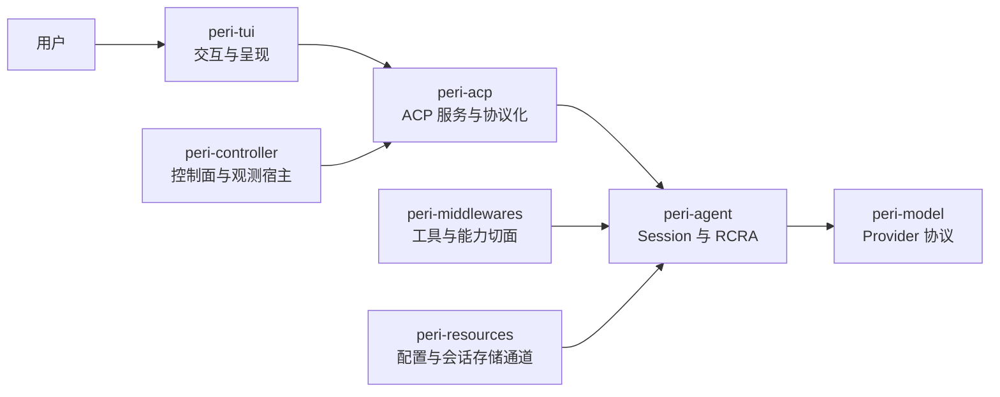
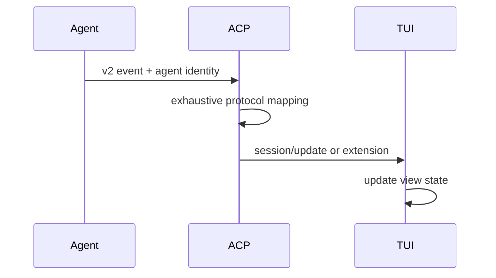

import { Aside } from '@astrojs/starlight/components';

Peri 把模型协议、Agent 执行、能力装配、ACP 协议和终端呈现拆成不同边界。分层的目的不是增加抽象数量，而是明确一项状态由谁持有、一项决策由谁执行、一个事件在哪里被协议化。

## 当前主链



这张图是职责视图，不是完整 Cargo 依赖图。实际依赖关系以 workspace manifests 为事实源。

## 各边界负责什么

### TUI：只把协议状态变成界面

`peri-tui` 发送 prompt、cancel、session 等 ACP 请求，消费流式消息、工具状态、SubAgent 状态和终止通知。它可以在启动阶段复用配置类型，但不直接调用 `run_react_loop` 驱动 Agent。

这条边界的重要结果是：一个终止事件不仅是 Agent 内部状态，还必须经过 ACP 到达客户端，使界面离开 loading。

### ACP：定位、映射和传输

`peri-acp` 管理 ACP 会话入口、请求分发、能力门控和事件协议化。它负责把 Agent 的内部事件转换成客户端能理解的协议通知，不拥有 Agent 的最终执行权。

新增事件需要沿完整链路核对：

```text
Agent 发射 → 协议序列化映射 → ACP 转发/门控 → TUI 消费
```

内部事件使用单一发射源。历史上的 TUI 双轨直连已退役；兼容载体只保留协议边界所需的最小映射。

### Agent：Session 聚合根和执行权

`peri-agent` 持有会话消息、冻结数据、执行阶段和取消判定。RCRA 循环为：

```text
MessageQueue → Receive → Compact → Reason → Act
                    ↑                    │
                    └────────────────────┘
```

`Receive` 是消息消费与退出判断入口；`Reason` 调用模型；`Act` 执行工具并原子提交 AI 消息与工具结果。会话创建时冻结 system prompt、项目指引、Skills 摘要和日期，后续 turn 与 SubAgent 复用这份数据。

### Middlewares：声明能力，不夺取生命周期

`peri-middlewares` 提供工具、MCP、Skills、Plugin、审批、Hook、Goal 和 SubAgent 等能力。生产链顺序会影响 prompt 贡献、工具注册和执行前后处理，因此属于行为契约。

链序的事实源是 `peri-agent/src/session/factory.rs` 中的 `production_blueprint`；构造实现位于 `peri-middlewares/src/assembly.rs`。不能按名称排序，也不能为了局部方便任意重排。

### Model、Resources 与 Controller

- `peri-model` 封装 Provider 消息、流式传输、协议差异和模型错误，不解释 Agent 会话语义。
- `peri-resources` 提供配置和会话存储等外部数据通道，不负责 Agent 的业务决策。
- `peri-controller` 承担控制面入口，并作为 Langfuse 旁路消费者的宿主。观测读取事件，不参与决定业务结果。

## 三条关键契约

### 1. 决策权跟随状态所有者

Agent 判断 turn 是否结束以及 cancel 最终如何生效；上层负责定位和转发。取消请求按 session、turn、attempt 身份定位，默认不等于清空待办消息。

### 2. 序列化顺序必须确定

Prompt cache 依赖稳定前缀。工具注册和 Provider payload 不能直接依赖 `HashMap` 的迭代顺序；使用稳定排序、固定注册顺序或有序容器。

### 3. 工具可见性由工具自身声明

`BaseTool::is_direct()` 是可见性的事实源。direct 工具直接进入模型工具表；deferred 工具由搜索工具发现，再由统一执行入口调用。包装层必须保留这个语义。

## 事件为什么强调单一事实源

同一个业务事件如果沿两条链到达 TUI，会出现重复、乱序或身份字段不同。Peri 的稳定契约要求 Agent 只发射 v2 事件，ACP 在协议边界做穷尽映射，TUI 只消费协议化路径。



终止事件还承担 UI 生命周期责任。缺失终止通知时，即使 Agent 已停止，客户端仍可能保持 loading。

## 证据入口

| 结论 | 当前事实源 | 验证入口 |
| --- | --- | --- |
| TUI 不直接驱动 Agent | `docs/standards/architecture-contracts.md` 的边界契约 | 检查 prompt/cancel/session 请求经 ACP client/transport |
| frozen 数据会话内不漂移 | frozen 契约、Session 与 SubAgent 构造代码 | `cargo test -p peri-middlewares --lib frozen_claude_md` |
| 事件为单链路 | 事件契约、`peri-acp/src/event/` | `cargo test -p peri-acp --lib mapper`、`cargo test -p peri-agent --lib events_v2` |
| 工具 direct/deferred | 工具契约、tool search 实现 | `cargo test -p peri-middlewares --lib core_tools` |
| keepgoing 终止可观测 | keepgoing 契约、session executor | `cargo test -p peri-agent --lib session::exec::executor_test` |
| 中间件顺序唯一 | `production_blueprint` 与 assembly | assembly 契约测试和人工槽位核对 |

<Aside type="note" title="设计文档与当前契约">
  `docs/top-level.md` 记录 3.0 的完整目标分层；`docs/standards/architecture-contracts.md` 记录当前必须遵守的跨模块不变量。两者出现差异时，先按代码、契约测试和 standards 判断当前行为。
</Aside>

## 相关内容

- [开发者入口](/peri-cool/docs/developer/)
- [3.0 分层重构](/peri-cool/docs/history/3-0-refactor/)
- [可验证工程里程碑](/peri-cool/docs/history/milestones/)
- [Agent Loop 工程文章](/peri-cool/posts/engineering/agent-loop/)
