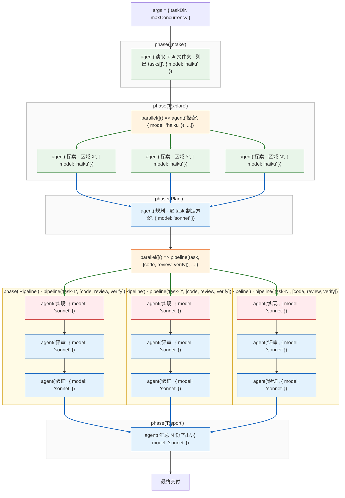

当任务多到一定程度——一个文件夹里躺着十几个待办——逐个让代理做太慢。把任务放进一个文件夹，对 Peri 说一句「执行这个文件夹里所有任务」，Peri 会把所有任务编排成一条流水线：**能并行的阶段全部并行，需要全局视野的阶段收窄，最后汇总成一份报告**。

整个编排呈**菱形**：窄入口（读取任务文件夹）→ 扇出变宽（多路探索并行）→ 收窄（全局规划）→ 再扇出最宽（每个任务一条流水线：实现 → 评审 → 验证，各自独立工作区）→ 收窄汇聚（汇总报告）。

图例：绿色加粗=扇出，蓝色加粗=汇聚；绿节点=低成本模型档位，蓝节点=高档位；红边节点=写阶段。

## 编排结构与并行方式

| 阶段 | 形状 | 并行方式 | 模型档位 |
|------|------|---------|---------|
| Intake | 窄（1 节点） | 读取任务文件夹，列出全部任务（一个不漏） | haiku |
| Explore | 宽（×R 扇出） | 多路探索者分区域并行 | haiku |
| Plan | 窄（1 节点） | 需要全局视野，汇聚探索结果后统一规划 | sonnet |
| Pipeline | 最宽（×N 扇出） | 每个任务一条流水线：实现 → 评审 → 验证，各自独立工作区 | sonnet |
| Report | 窄（1 节点） | 汇聚全部产出，输出一份总报告 | sonnet |

## 并发安全

- **任务互不干扰**：每个任务在独立工作区执行，写阶段只写自己的工作区。
- **同一代码库不会被并发写坏**：并行写限定在各任务自己的工作区，不在同一份代码上打架。
- **单个任务失败不影响整体**：失败的任务被隔离，其余任务照常推进。
- **并发度有上限**：受 `maxConcurrency` 限制，不会耗尽资源。
