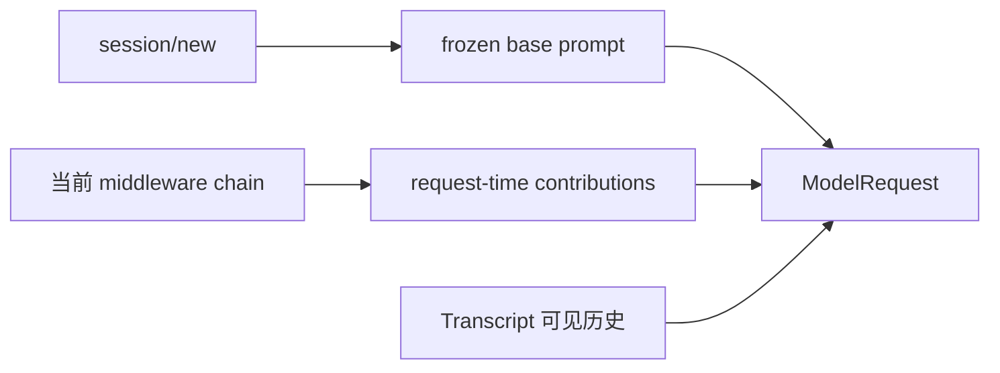

上下文不是越多越好。项目规则、对话历史、工具定义和工具结果都会占用模型窗口；重复、
过时或没有行动价值的内容会增加请求成本，也会让当前任务的证据更难定位。

Peri 用四个边界控制这件事：会话级冻结快照、request-time contribution、Compact 投影，
以及 Skills 与 deferred tools 的渐进式发现。

## System Prompt 有冻结区和动态区



base prompt、Meta Harness 状态和项目静态输入在创建会话时形成快照。load、resume、fork
与 SubAgent 复用这份 owner snapshot，避免同一会话在磁盘变化后悄悄换一套基础规则。

middleware contribution 在每次模型请求前从当前生产链读取。项目指引、Skills 摘要、
Git attribution 与 session-local 工具说明可以通过这一区域加入请求。它们位于冻结前缀之后，
不会回写 Transcript。

<Aside type="note">
  稳定前缀只提供 Prompt Cache 的复用条件。是否命中、保存多久以及怎样计费，仍由 Provider
  和模型决定，应以实际 usage 字段为准。
</Aside>

## 项目指引文件是路由，不是文档仓库

Peri 从候选路径中选择第一个存在的项目指引。会话冻结入口只检查当前工作目录下的：

```text
AGENTS.md
CLAUDE.md
.claude/AGENTS.md
```

它不会向父目录递归继承。因此在子目录启动 Peri 时，需要让该目录自己的指引明确路由到
适用规则。普通 middleware 路径还可以追加用户级 `~/.claude/AGENTS.md` 与宿主提供的额外
路径，同样只选择第一个匹配项。

选中的 `CLAUDE.md` 支持 `<!-- @import path -->`，递归深度和循环受到限制；`AGENTS.md`
不展开这套 import。import 只是组织文件的方式，被导入内容仍会进入上下文，不能用它规避
体积成本。

一份有效的根指引通常只保留：

- 事实优先级和必须遵守的少量不变量；
- 按任务查找模块说明、标准、设计与 active issue 的路由；
- 常用验证命令；
- 容易造成真实错误的项目特定陷阱。

模块 inventory、事故过程、实现细节和规范正文应留在各自事实源中，不要复制进根指引。

## Compact 不修改原始消息正文

自动 Compact 发生在 Agent Loop 的 Compact 阶段。当前主要有两级：

- **Micro Compact**：生成投影计划，对较旧的工具输入、结果或媒体做字段级压缩；
- **Full Compact**：用摘要替代一段可见历史，并按预算重新注入必要文件与 Skill 信息。

Micro 使用标记和持久化 projection directive 重建模型视图。原始 Transcript 正文保留，
Reason 阶段将投影应用到副本后再发送给模型。ToolUse 与 ToolResult 必须继续配对，JSON 根类型
和 Provider 对 reasoning block 的限制也必须保持。

Full Compact 会把旧消息标为 excluded，再追加带续接提示的 Human 摘要。失败时会显式降级，
不会把一次压缩失败误写成任务完成。

`smart_compact_enabled` 是兼容开关，不是新项目应依赖的第三套主路径。需要手动释放上下文时，
可以使用 `/compact`；想完全清空对话历史时使用 `/clear`。两者语义不同。

## 工具与 Skills 按需进入上下文

direct 工具的 schema 直接进入当前模型请求。deferred 工具保留在 session-local 注册表中，
先通过 `SearchExtraTools` 发现，再通过 `ExecuteExtraTool` 调用。这样低频、动态工具不必全部
常驻每一轮请求。

Skills 先以 name 与 description 摘要参与能力发现，需要时再加载 `SKILL.md` 全文。MCP
提供的远端 Skill 也进入 session catalog，但其正文和关联资源仍受来源绑定与当前 MCP 连接约束。

## 子代理隔离工作上下文

适合独立交付的调查、实现或验证可以交给 SubAgent。子代理拥有自己的消息历史和工具视图，
同时继承父会话冻结的项目上下文。主会话接收的是交付结果，不需要承载子代理的全部搜索过程。

隔离不等于自动正确：任务边界、允许工具、写入范围和验收条件仍需明确。共享写入面应由唯一
owner 收敛，不能因为并发而让多个 Agent 同时改同一组文件。

## 长任务建议

1. 把目标、工作包、验证证据和剩余风险写入项目文件或 Goal，不依赖聊天记忆。
2. 对可独立验证的子任务使用 SubAgent；跨阶段、可重放的批量流程使用 Workflow。
3. 每完成一个可验证切片就运行目标测试，并更新事实记录。
4. Compact 后先读取任务记录和当前 diff，再继续修改。
5. 不要把日志、大段工具输出或重复规则复制到项目指引。

相关内容：[项目指引文件](/docs/features/claude-md/) · [工具系统](/docs/features/tools/) · [Skills](/docs/features/skills/) · [管理长任务](/docs/features/long-running-tasks/)
