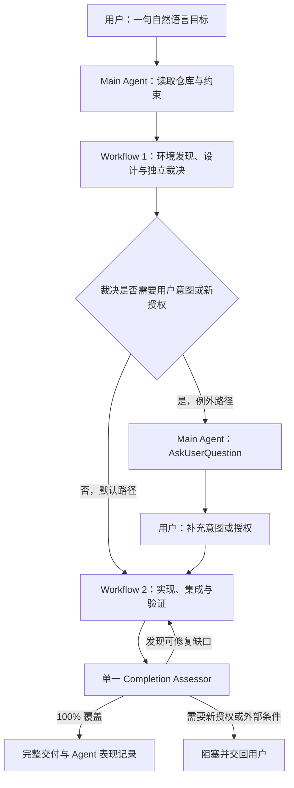

Ultra-ADLC 面向跨模块、长周期、必须完整交付的超大规模开发任务。用户不需要先了解
仓库结构、实现文件或测试命令，只需要描述最终目标：

```text
/ultra-adlc 实现一个插件系统，支持从远程仓库安装、升级和回滚插件
```

Peri 会先调查环境，比较候选方案，再交给一个未参与前序设计的高阶 Agent 独立裁决。
普通、可逆且不扩张权限的选择不会打断用户；只有缺失产品意图、新授权、secret 或
外部状态、法律或财务接受、不可逆动作，或目标无法决定且会实质改变用户结果时，Peri
才集中提问。随后系统进入实现与验证阶段；在独立完成度评估证明全部范围已经覆盖前，
任务不会被标记为完成。

## 什么时候使用

适合 Ultra-ADLC 的任务通常同时具备多项特征：

- 跨多个模块或独立工作流；
- 需要架构设计、实现、测试、文档和迁移一起交付；
- 可以把相互独立的调查、实现或验证工作并发执行；
- 不能接受“先完成核心部分，其余以后再说”。

普通功能、局部修复、代码审查或一次性并行任务不需要 Ultra-ADLC。使用常规开发流程会更快。

## 人机协作流程



流程只有两个逻辑 Workflow。Workflow 1 中的 synthesizer 负责准备完整的候选方案和证据，
随后由一个 fresh `opus` Decision Arbiter 裁决。裁决材料按 revision 冻结：synthesizer 只写
候选文件，Main Agent 以不可覆盖方式发布 final packet，再记录并复核内容 SHA-256。每次裁决
直接收到 Main Agent 已验证的同一份内容；第二次 Opus 和条件 Fable 重试不会重新综合或从
可变路径重新读取同名 packet。完整材料经两次 fresh Opus 仍无法形成合法裁决时才升级
`fable`。执行 Agent 不会直接向用户提问，裁决也不会授予 commit、deploy、删除数据或修改
外部系统等额外权限。

## 三份契约

每个任务在项目内写入 `.peri/adlc/tasks/<adlc-id>/`。三份文件是唯一的任务契约：

| 契约 | 回答的问题 |
| --- | --- |
| `contracts/intent.md` | 为什么做、最终必须交付什么、哪些内容不在范围内 |
| `contracts/execution.md` | 工作如何拆分、依赖关系、负责人和验收方式 |
| `contracts/evidence.md` | 哪些证据证明全部需求和工作包已经完成 |

决策、Agent 交接、测试产物和运行记录属于审计材料，不会变成额外契约。

```text
.peri/adlc/
├── tasks/
│   └── <adlc-id>/
│       ├── manifest.json
│       ├── contracts/
│       │   ├── intent.md
│       │   ├── execution.md
│       │   └── evidence.md
│       ├── decisions/
│       ├── handoffs/
│       ├── artifacts/
│       └── learning/
│           └── agent-performance.md
└── evolution/
    ├── records/
    ├── routing-observations.md
    └── eval-candidates/
```

文件系统交接使每个 Agent 的输入、结论、验证命令和遗留问题都可追踪。Main Agent
也可以在上下文压缩或任务恢复后从这些记录继续执行。

## 并发与模型分工

Ultra-ADLC 优先缩短关键路径，而不是让所有工作都使用同一个模型：

| Profile | 典型职责 |
| --- | --- |
| `haiku` | 清单、搜索、格式检查等低风险机械任务 |
| `sonnet` | 边界清楚的实现、测试、修复和普通审查 |
| `opus` | 需求综合、默认独立裁决、架构冲突、高风险审查和最终完成度评估 |
| `fable` | 完整裁决材料经两次 fresh Opus 仍无法合法收敛后的升级裁决 |

互不依赖且写入范围不冲突的工作会并发执行；存在依赖或共享写入面的工作保持串行。
Ultra-ADLC 复用现有 Workflow 调度能力，不增加新的 DAG 或执行引擎。

## 如何看任务进度

Peri 的中间、阻塞、恢复和最终汇报都会显示整体百分比、当前阶段、分母 revision，以及
完成、进行中、剩余和阻塞项。编号不会单独出现：例如显示
`WP-004 — 实现升级失败后的事务回滚`，而不是只有 `WP-004`。

整体进度不把四个维度取平均，而采用其中最低值：

```text
overall_progress_percent = min(
  需求覆盖率,
  工作包完成率,
  验收证据通过率,
  缺口关闭率
)
```

只有已有当前、可复查证据的项目才计为完成，进行中的项目不按 50% 等方式估算。必需检查
计入验收证据；已发现缺口会保留在分母中，直到有证据证明关闭，没有已发现缺口时缺口关闭率
为 100%。范围或完成条件变化时会更新 denominator revision，因此扩展范围后百分比可能下降；
报告会明确说明这是分母变化。即使显示 100%，仍需独立 Completion Assessor 给出 `complete`
才能结束任务。

## 完成意味着什么

Ultra-ADLC 没有“部分完成”终态。合法终态只有：

- `complete`：独立 Completion Assessor 证明需求、工作包、验收场景和必需验证均已覆盖；
- `blocked`：需要新的用户授权、外部系统或当前无法取得的证据；
- `cancelled`：用户取消任务。

评估发现的可修复缺口会重新进入 Workflow 2，完成修复、集成和复验。只有评估通过后，
系统才会生成 `learning/agent-performance.md` 与 evolution record，记录本次 Agent 的有效做法、
缺点和路由信号。单次记录不会自动修改内置 Skill、项目指引或模型配置。

## 当前边界

- 任务运行状态继续通过 `/workflows` 和 `/tasks` 查看，没有独立的 ADLC 面板；
- 未经用户单独授权，不会自动 commit、push、发布、部署或修改外部系统；
- Ultra-ADLC 不会把密钥、令牌或密码写入 `.peri/adlc/`；
- ADLC 记录是本地审计，默认被 `.peri/*` 忽略，未经单独授权不会 commit；
- 外部依赖不可用时，任务会明确进入 `blocked`，不会用缩减范围制造完成结论。
- 原始 Workflow journal 仍保存在 `.claude/workflow-runs/<run-id>/`；ADLC 目录只保留精简 provenance，不复制完整运行日志。
