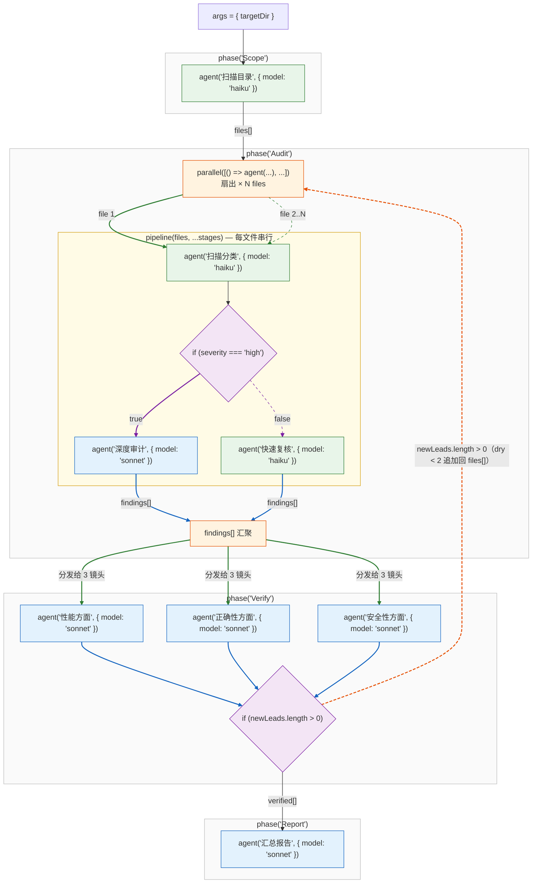

`/ultracode` 是 Peri 内置的编排引擎——你描述任务，Peri 生成并执行编排脚本，把多个代理按阶段组织起来。下面这张图是编排引擎的完整模式：**并行扇出、流水线、阶段标记、条件分支、验证关口、模型分层、收敛循环**。看懂这张图，一条复杂命令背后 Peri 是怎么拆解执行的，一目了然。

图例：绿色加粗=扇出（一个任务拆给多个代理），蓝色加粗=汇聚（结果合并），紫色=条件分支，橙色虚线=收敛回灌；绿节点=低成本模型档位，蓝节点=高档位。

## 七种模式

| 模式 | 作用 | 图中位置 |
|------|------|---------|
| **并行扇出** | 一个任务拆给多个代理同时跑 | 橙色 `parallel` 节点，绿色双路扇出（`file 1` 实线 / `file 2..N` 虚线），同构进入同一条流水线 |
| **流水线** | 文件逐个经过「扫描分类 → 判断 → 审计/复核」串行处理 | P_AUDIT 内浅黄框 |
| **阶段标记** | 每个阶段独立命名，任务分阶段推进 | 子图标题 `Scope / Audit / Verify / Report` |
| **条件分支** | 按代理输出决定走哪条路（如 `severity === 'high'` 走深审，否则快速复核） | 紫色菱形（实线 true / 虚线 false） |
| **验证关口** | 多个视角并行审查，全部通过才放行到下一阶段 | 三节点并行投票（性能 / 正确性 / 安全）→ 蓝色汇聚 → `verified[]` 才进 Report |
| **模型分层** | 扫描类用低成本档位，深审与汇总用高档位 | 绿=haiku，蓝=sonnet |
| **收敛循环** | 发现新线索则回灌重新处理，直到没有新线索（`dry < 2`）才退出 | 橙色虚线回边（新线索重新入扇出） |
