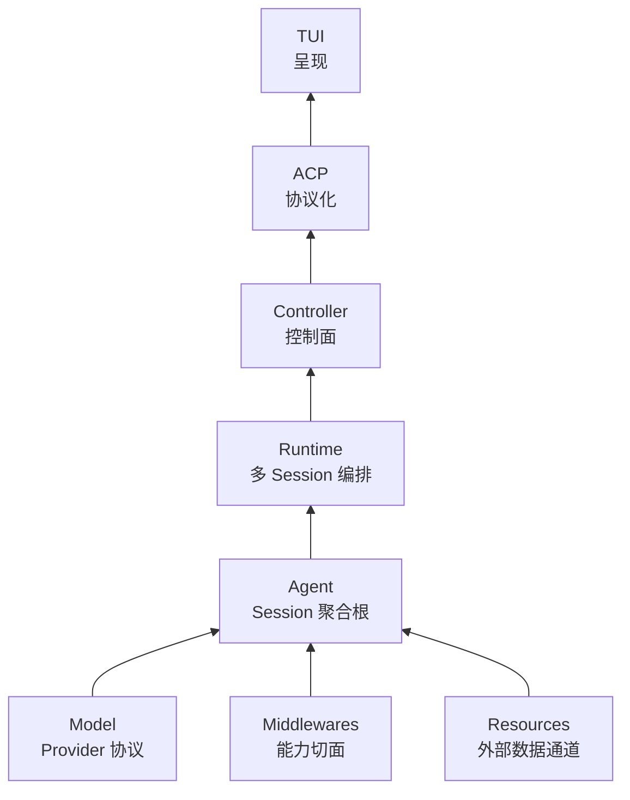

import { Aside } from '@astrojs/starlight/components';

Peri 的 3.0 分层重构解决的是职责和生命周期错位，不是一次性能优化。重构主线在 2026-08-05 建立决策记录，主要迁移于 2026-08-06 合入，并在 2026-08-11 归档。

这里的日期分别来自 spec 的创建/归档记录与 commit 日期。`agent-v3.0.0` tag 创建于 2026-08-02，早于这次分层迁移，因此这段历史不是“v3.0 首发记录”。

## 重构前的问题

3.0 伞形 PRD 对 v2.x 主线做了跨层审计，记录了几类已由代码和迁移 issue 支持的问题：

- `peri-acp` 同时承担协议、Agent 装配、执行入口和 Langfuse 观测宿主，协议层需要理解大量业务职责。
- TUI 进程内存在直连执行和事件双轨，部分事件绕过 ACP 的能力门控。
- 后台任务与 SubAgent 的生命周期分散在 Middleware、ACP 和 Agent 多条路径，多 session 下难以用一个所有者解释。
- SQLite 会话存储位于 Agent 侧，访问通道与会话业务语义没有清晰分开。
- Langfuse 嵌入业务路径，观测归属曾依赖并发完成顺序和无身份栈近似。

这些是分层与可推理性问题。仓库没有提供一组能把此次重构归因到吞吐、延迟或内存变化的对照数据，因此本文不宣称性能提升。

## 目标：让职责跟随生命周期



目标分层文档使用三个判断问题：

1. **状态活多久**：跟随 session 的状态归 Agent；跨 session 的定位与编排归 Runtime/Controller。
2. **数据来自哪里**：模型协议归 Model；ACP wire 归 ACP；配置、存储和连接等外部通道归 Resources。
3. **谁消费结果**：界面呈现归 TUI；观测作为旁路消费者，不参与业务决定。

这张图表达设计方向。当前稳定不变量应以 `docs/standards/architecture-contracts.md` 和代码为准。

## 迁移分片

### L1：后台任务归 Agent

后台任务从 Middleware 的持有状态迁到 `peri-agent/src/agent/async_tasks.rs`。Middleware 仍可定义或发起任务，但任务生命周期、取消与事件跟随 Session 所有者。

### L2：生产装配由 Agent 给出蓝本

中间件链从 ACP builder 迁出，Agent 层的 `SessionFactory` 成为统一创建入口。当前链序蓝本是 `peri-agent/src/session/factory.rs::production_blueprint`，构造实现位于 `peri-middlewares/src/assembly.rs`。

迁移后的关键约束不是“文件移动了”，而是生产顺序只有一个事实源。

### L3：SubAgent 创建统一

原先分散的 spawn、fork、background 和 builtin 创建路径归到 `peri-agent/src/session/subagent.rs`。统一入口共享 thread 父子关系、冻结数据、工具边界和生命周期收尾。

### L4：Langfuse 成为旁路消费者

Langfuse 从 ACP 内嵌模块迁到 `peri-controller/src/langfuse/`。业务事件在协议化前分支给观测桥；观测失败不应改变 Agent 的业务结果。

并发 SubAgent 的归属也从 LIFO 栈近似改为按 `agent_id` 注册和路由。历史记录仍显示后续修过 observation 关闭时序，因此不能把“旁路化”写成观测问题从此全部消失。

### L5：Executor 执行体回到 Agent

RCRA 与 Session 执行体迁到 `peri-agent/src/session/exec/`，ACP 只保留协议化薄壳和装配宿主。cancel 的最终判定与 Model 中止由 Agent 发起，上层定位并传递请求。

### M：事件与资源单一事实源

- 事件三通道收敛为 Agent v2 事件经 ACP 协议化到 TUI 的单一路径，TUI 的 `v2_tx` 双轨直连退役。
- 新建 `peri-resources`，承载配置、会话存储和 LSP context 等外部数据通道。

## 迁移如何避免“只搬文件”

伞形 PRD把验证分为三种 seam：

1. **E2E 行为基线**：迁移不应改变既有协议可见行为。
2. **时序契约测试**：身份、cancel、session sequence、终止顺序和消息队列语义由类型与测试固定。
3. **依赖方向门禁**：用 workspace 脚本检查不允许的跨层依赖。

当前架构契约给出更具体的验证入口：

```bash
cargo test -p peri-controller --lib controller
cargo test -p peri-runtime --lib runtime
cargo test -p peri-acp-types --lib identity
cargo test -p peri-acp --lib mapper
cargo test -p peri-agent --lib events_v2
cargo test -p peri-agent --lib model_bridge
```

这些测试分别覆盖自己的契约面。它们组合起来提高迁移可信度，但不等于自动证明所有客户端场景没有回归；跨层变更还需要按 `e2e/CLAUDE.md` 运行对应场景。

## 已知边界

- 3.0 PRD明确把性能调优列为范围外；本文没有性能结论。
- 多客户端 attach 在该 PRD 中只落实了 writer lease 方向，协议级扩展不属于这次迁移。
- provider 工厂和模型实例生命周期在 PRD 归档文本中仍保留未完全收口的跟踪说明。
- `docs/design/architecture.md` 已收敛为现行总体设计；当前实现发生变化时，仍应先查代码、契约测试和 standards。

## 证据入口

- 伞形 PRD：`spec/archive-issues/architecture/2026-08-05-peri-3.0-refactor-prd.md`
- 当前跨层契约：`docs/standards/architecture-contracts.md`
- 当前权威设计索引：`docs/design/README.md`
- 历史索引：`spec/global/problems.md` 与 `spec/global/domains/agent.md`
- 3.0 主线合入：commit `1fcacf75`
- 具体实现：`peri-agent/src/session/`、`peri-controller/src/`、`peri-resources/src/`、`peri-acp/src/event/`

## 相关内容

- [架构总览](/peri-cool/docs/developer/architecture/)
- [开发者入口](/peri-cool/docs/developer/)
- [可验证工程里程碑](/peri-cool/docs/history/milestones/)
