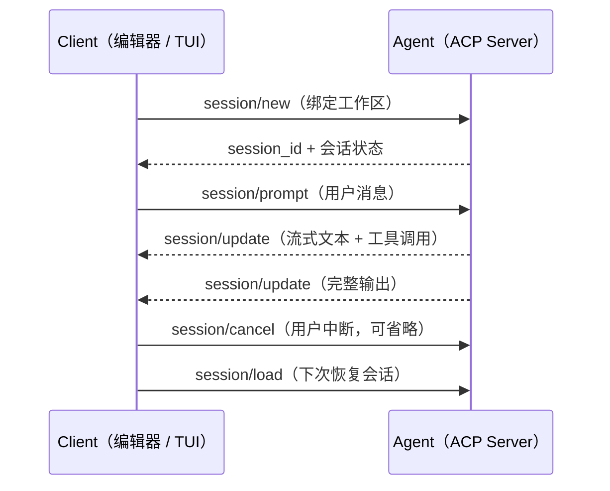
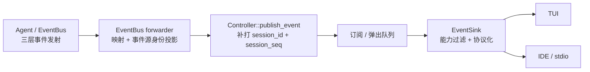

import { Aside } from '@astrojs/starlight/components';

## 协议层的位置

[Agent Client Protocol](https://agentclientprotocol.com)（ACP）是 Zed Industries 发起、社区维护的开放协议，定义编辑器（Client）与 AI 编程 Agent（Server）之间的通信，走 JSON-RPC 2.0。协议的方法集中在几个根命名空间，`initialize` 做能力协商，`session/*` 管理会话生命周期，`session/prompt` 驱动单轮交互；执行过程中的状态增量由 Agent 侧通过 `session/update` 等通知持续推回客户端，而不是等一轮结束给一个大块结果。

Peri 在这套协议里有两个身份，它是实现 ACP Server 的 Agent，同时它的 TUI 外壳又是一个 ACP Client。两个身份共用同一套协议层，没有为 TUI 另开一套内部事件格式——协议本身就划定了这条边界。这篇文章站在 peri-acp 的实现上，拆解它的四个设计维度，**分层**、**事件链**、**序列化契约**、**多实现方**。涉及的具体文件在文中标出，协议设计的事实均以当前源码为准。

### 协议生态范围

协议的意义在于形成多对多网络，Agent 实现一次 ACP Server，就能被所有声明了对应 capability 的 Client 接入；编辑器实现一次 ACP Client，就能使用所有 ACP Agent。按 [ACP 官网](https://agentclientprotocol.com) 登记页的数据，已有 40+ Agent 实现与 80+ 客户端表面（IDE、聊天桥接、Web UI、Jupyter、Unity 等），并有 Rust、TypeScript、Python 等语言的 SDK。Peri 属于 Agent 实现方，同时用自己的 TUI 客户端做协议一致性验证。

有一个前提需要先说清，实际可用范围取决于双方协商的协议版本与 capability，而不是看客户端是否挂了ACP标签。Peri 的协议面基于 `agent-client-protocol` SDK 的 schema v1 实现，下文的协议语义都指 v1。

## 会话、请求与事件分层

一次交互被拆成三个粒度。这个划分不是文档上的说法，三个粒度在 peri-acp 里对应三个模块目录（`src/session/`、`src/prompt/`、`src/event/`）。

| 层 | 边界 | peri-acp 侧承担 |
| --- | --- | --- |
| **session** | 工作区绑定的生命周期 | 会话创建/加载/恢复/关闭，持久化，重对象复用 |
| **prompt** | 单轮输入的执行 | system prompt 装配、单轮执行、结果回传 |
| **event** | 执行过程中的状态增量 | 内部事件到协议通知的流式映射 |

### session，一个会话是一份冻结的上下文

`AcpSession`（`peri-acp/src/session/mod.rs`）的字段说明一次会话在 Peri 里意味着什么，

- 每个 session 有一个 `session_id`、一个关联的 `thread_id`（对应一条 ThreadStore 记录）、一个绑定的工作目录 `cwd`、一个取消令牌（`CancellationToken`）、一段 `state_messages`；
- 会话级状态，当前 `provider_id`、`model_alias`、权限模式（`Arc<SharedPermissionMode>`）、goal steering 状态（跨 prompt 共享）；
- 运行期状态 `active_agents`（`ThreadId → AgentRuntime` 映射），同时持有根 agent 与子 agent；
- 一个会话级共享的 `MessageQueue`，统一收件箱，main agent 与 SubAgent / Hook / GoalSteering 互可见彼此的 deferred 与 info 消息。

两个关键设计值得展开。

**冻结数据。** 会话创建时形成的 owner snapshot 从创建时刻保持不可变。frozen base prompt、项目静态输入和 Meta Harness 状态随 ThreadStore 持久化，`session/load`、resume、fork 与 SubAgent 复用同一快照；每次请求的 middleware contribution 只能追加在冻结前缀之后。这也是 session 层区别于聊天窗口的地方——会话是一个可恢复的持久化单元，不是一次请求。

**按 session 复用重量级资源。** 与会话绑定的资源池在会话创建时装配、跨 turn 复用，`AgentPool`（`session/agent_pool.rs`）缓存 LLM 实例与其持有的 `reqwest::Client`（代码注释估计单个客户端约 1–2 MB，含连接池与 TLS 会话缓存），首次 prompt 时填充、provider 切换时失效；LSP 池与 workflow 中间件以端口形式注入（`Arc<dyn LspPoolPort>` / `Arc<dyn WorkflowMiddlewarePort>`）。这解释了协议的抽象粒度，session 是大粒度资源的边界，prompt 是轻量输入。

顺带提一个实现现状（L5 重构后），`AcpSession` 本身瘦身为对外句柄，核心状态委托给 `peri-agent::session::Session`，ACP 层保留的是协议特有字段。阅读代码时，不用再在 `AcpSession` 里找全部执行状态。

一次典型的交互遵循下面的周期（演示示例，不是真实会话），

### prompt，冻结 base 与动态 contribution 组合

`session/prompt` 收到输入后，执行层读取会话创建时冻结的 base prompt，再从当前 middleware 链收集 request-time contribution，组合后运行一轮。基础段与能力段分别由对应 middleware 持有；middleware 缺席时，它的段落、工具和 Hook 必须一起消失。

单一条件源是当前 middleware 链。它同时导出段落所有权、direct 工具、deferred-tool 搜索和命令投影，避免多处判定漂移。`PermissionMiddleware` 持有审批与 `10_hitl`，`HumanInTheLoopMiddleware` 持有提问工具与 `12_ask_user`；两项能力不能互相代替。`15_channel` 仍由关闭的 feature gate 保留，不算当前可用能力。

单轮结果统一用 `PromptResult`（`peri-acp-types/src/session.rs`）回传，消息历史、是否成功、停止原因、本轮是否发生 compact 替换可见历史。prompt 层只负责把输入变成一轮执行，状态管理归 session。

### event，状态增量流

Agent 执行是流式的，文本块、推理、工具调用、上下文告警持续产生。协议面把这些增量映射为 `session/update` 通知，而不是等一轮结束给一个大块结果。事件的具体设计（分类、身份、可靠性）是下一个维度的内容，这里只说明它属于第三层，而且粒度分层是双向受益的，客户端得到更早的反馈，服务端也不必缓存整轮结果再发送。

<Aside type="note">
  三层的边界从目录结构也能看出来，session 生命周期与重对象管理在 `src/session/`，prompt 装配在 `src/prompt/`，事件映射与转发在 `src/event/`。一个请求从协议进入后依次穿过这三层，方向与依赖都单向。
</Aside>

## 事件链保留统一身份

事件这一层的难点不在格式，而在身份一致性。Peri 早期踩过的坑可以作为这个问题的注脚（归档记录 `issue_2026-07-25-event-identity-diverges-across-dual-delivery-paths` 与 `issue_2026-08-05-3.0-m-event-chain-canonical`）。

**现象。** 同一个 Agent 事件曾有两条投递路径，一条走 ACP transport 序列化，一条是 v2 事件到 TUI 本地 DTO 的直连 mapper（`v2_bridge`，后已删除）。两条路径各自维护映射与抑制规则，`message_id`、`source_agent_id` 在转换中被替换成默认值或 `None`。同一事件经双轨落地后身份不一致，外显症状包括，文本与工具卡片重复（同一内容走两个路径）、并发消息无法按稳定 `message_id` 归组、SubAgent 事件在部分路径丢失来源标识、TUI 与 IDE 对同一新增事件表现不一致。

**归因。** 根因是事件语义有多个事实源，身份字段由各 mapper 临时补齐，而不是由统一契约承载。映射器之间的 wildcard 分支还让新增事件静默落入不产生下游更新的分支，错误路径没有被显式暴露。

**修复。** 收敛为单事实源链路，

具体契约（类型落在 `peri-acp-types` 的 `identity.rs` / `runtime.rs` / `event_v2.rs`），

- 每个事件强制携带 `turn_id`（`TurnId`，UUID v7，一次 turn 内所有事件的统一纽带）与 `agent_id`（来源标识，SubAgent 场景即 source）；
- `session_id` 与 `session_seq` 由 Runtime 在聚合时补打（`Controller::publish_event` 语义），同 session 事件带单调递增序号，配合 `session_epoch` 防止迟到消息命中新 session；
- canonical envelope 类型 `UnstampedEvent`（事件源身份的最小投影）→ `EventEnvelope`；`SessionSeq` 特意**不实现 `Default`**——必需身份缺失时拒绝构造，而不是用默认值伪装（契约测试对此有编译期断言）；
- 映射对 canonical 事件穷尽匹配，新增事件变体无法落入丢弃分支；
- TUI 只经 ACP 拿数据，v2 双轨直连离线。

**事件分层。** 事件按消费者视角分三层（`event_v2.rs` 的枚举定义），全部强制携带 `turn_id` 与 `agent_id`，

- **渲染层**，`TextChunk` / `ThinkingChunk` / `ToolStarted` / `ToolEnded` / `BudgetWarning` / `HitlPending`，驱动实时 UI；
- **状态层**，`TurnCompleted` / `StateSnapshot` 等，驱动 transcript 提交与恢复；
- **观测层**，`LlmCallStart` / `LlmCallEnd` / `MessagesCompacted` / `TurnError` / SubAgent 启停等，供观测与调试。

可靠性按层取舍，渲染与状态层走有界 mpsc 通道 + `try_send`，通道满时降级丢弃，保证慢消费者不阻塞 ReAct 循环；观测层走 broadcast 通道，慢消费者滞后自动跳过（lagging）。这里有一个不能回避的边界，**critical 通道满时的丢弃是有意设计，不是缺陷**，依赖状态层快照兜底。对每事件必达有硬性要求的场景，需要按这个边界重新评估。

<Aside type="note">
  渲染层必须先于状态层被消费，转发器（`peri-acp/src/event/forwarder.rs`）里的 biased `select!` 通道顺序被注释标记为不可移除——否则下一轮的 `TextChunk` 会先于上一轮的 `TurnCompleted` 落地，渲染出错乱。这类顺序前置条件写进了代码注释，属于实现必须维护的不变量。
</Aside>

## 序列化固定协议边界

协议面与内部实现的边界由一层契约 crate 划定，`peri-acp-types` 承载所有跨层接口类型与 serde 序列化形态，`peri-acp` 只做映射、不外泄内部类型。三处典型契约，

**`AcpEvent`**（`peri-acp/src/event/mod.rs`，走 `peri/agent_event` 通知的 DTO）。带标签枚举，`serde(tag = type, content = value, rename_all = snake_case)`，只保留 TUI 消费者需要的字段。它替代了曾在同一通道上序列化的原始内部事件——TUI 反序列化后直接消费，不依赖内部 `ExecutorEvent` 或 `BaseMessage`。

**`AgentActivityWire`**（`peri-acp/src/event/activity.rs`，`peri.agentActivity` 投影）。这是隐私边界，把协议承载事件映射成紧凑 DTO 时，不复制原始消息、prompt、推理、工具 IO、摘要、路径、错误或 URL。DTO 带 `schema_version`，自由文本先做长度截断（128 字节上限）或白名单化，`correlation_id` 是命名空间加值的 SHA-256 哈希（取前 12 字节），映射对事件穷尽匹配——新增事件不会静默获得 activity 资格。

**标准 ACP `SessionUpdate`**（`peri-acp/src/event/mapper.rs`）。面向 IDE/stdio 客户端的七类输出（文本块、推理、工具调用、todo、usage 等）来自 `agent-client-protocol` SDK 的 schema v1。其中 `messageId` 语义是协议级约定——同一消息的所有 chunk 共享一个 ID，ID 变化即新消息，客户端据此做段边界与推理结束推断，Peri 的映射严格遵循这一点。

<Aside type="note">
  一个演进事实，v1 `ExecutorEvent`（`peri-acp-types/src/event.rs`）曾是 Agent 层的主要事件类型，现在只作为协议序列化面的载体保留——v2 事件经穷尽映射转成它，再 wire 化发给客户端。阅读相关代码时，不要把它当作内部 API 来依赖。
</Aside>

## 多种客户端共用协议层

协议的意义在于允许多方实现。Peri 内部就有两套典型的实现方，共享同一套契约。

**传输层。** `AcpTransport` trait（`peri-acp/src/transport/mod.rs`）定义四类操作，`send_request` / `send_notification` / `recv` / `send_response`。序列化方式由实现方决定，

- `MpscTransport`（`transport/mpsc.rs`），TUI 与 ACP Server 同进程，走内存通道，消息以结构化值传递，不做文本序列化；
- `StdioTransport`（`transport/stdio.rs`），外部 IDE 走 stdin/stdout 的 JSON-RPC 行协议。

**事件出口。** 对应的 `EventSink` 实现也是两套（`peri-acp/src/session/event_sink.rs`），`TransportEventSink`（TUI）除标准 `session/update` 外，还发 `peri/agent_event` 自定义通知（以及表示一轮终止的 `peri/agent_event_done`）；`StdioEventSink`（IDE）只发标准 `SessionUpdate`。`EventSink` trait 本身定义在契约层（`peri-acp-types::event`），核心执行逻辑对前端无感知。

**装配统一。** TUI / print / stdio 三路径共用同一份 host 装配（`peri-acp/src/host/assemble.rs`），cli 作为部署装配点启动它们。不同前端只提供协议面输入（provider、config、permission、thread store、cwd），不再各自复制装配逻辑；middlewares 的具体实现（cron、MCP client pool、skill 扫描、插件管理等）全部由这一处装配面内部构造。

多实现方的关键验证点是**语义等价**，同一组 canonical 事件，分别经 mpsc 与 stdio 两条通道后，下游得到的输入应当语义一致。这正是 canonical 事件链存在的理由——如果两条路径各自维护映射，等价性就无法被证明。

Peri 同时扮演两种实现方（TUI 自己是 Client，对外又是 Server），因此它被迫处理双份身份问题；canonical 事件链不是为好看而做的抽象，而是多实现方场景下的一致性兜底。

## 限制与边界

- **性能**，Mpsc 内存通道与 stdio 文本序列化的延迟差异没有实测数据，这里不估算。
- **可靠性**，critical 通道满时的丢弃是刻意设计，依赖状态层快照兜底，见事件链一节。
- **协议演进**，协议面基于 schema v1 实现（`agent-client-protocol` 2.x、`agent-client-protocol-schema` 1.5）。协议层的变化会先落在 `peri-acp` 的映射层，而不是内部事件链——这也是分层与契约层分离的价值。
- **生态数字**，40+ Agent / 80+ 客户端表面取 ACP 官网登记页的引用口径，未在本站单独核验。协议语义一节依赖的代码事实，则核验自上面列出的源码文件。

## 相关实现

- [Agent Loop](/peri-cool/posts/engineering/agent-loop/) — ReAct 引擎如何与 session/prompt 周期对齐
- [Hook 中间件总览](/peri-cool/posts/engineering/hook-middleware-overview/) — 中间件链如何挂在 ACP 事件生命周期上
- [Multi Agent 架构](/peri-cool/posts/engineering/multi-agent/) — SubAgent 的事件如何在 ACP 通道中上报
- [System Prompt](/peri-cool/posts/engineering/system-prompt/) — prompt 分段如何装配
