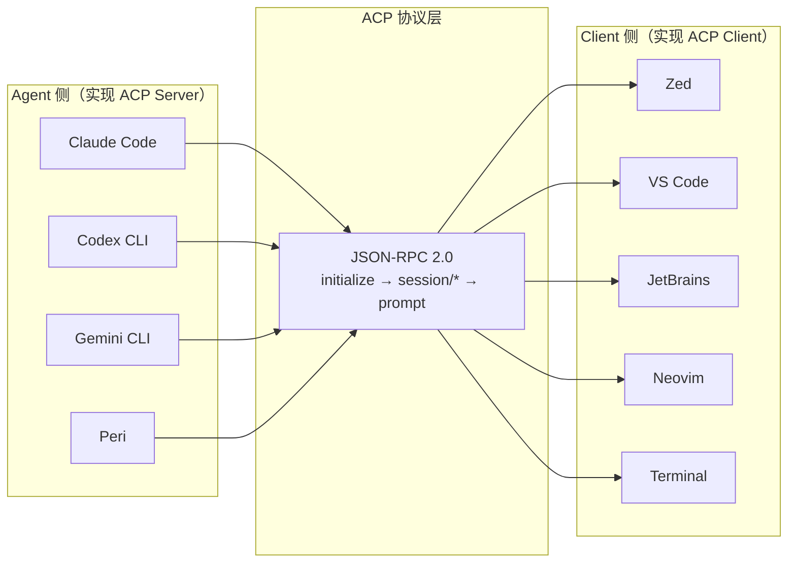
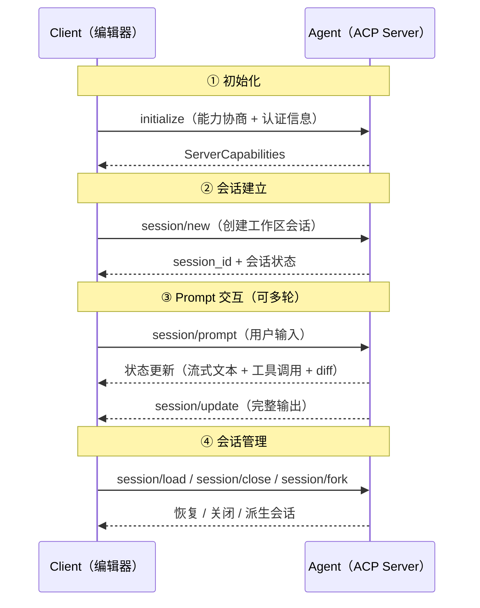

import { Aside, Card, CardGrid } from '@astrojs/starlight/components';

## 命题：AI 编程工具需要一个"USB-C 接口"

2025 年，AI 编程工具爆发式增长。Claude Code、GitHub Copilot、Codex CLI、Gemini CLI、Cursor、Junie——每个都是优秀的 Agent，但每一个都绑在自己的接口上。终端用户用 CLI，IDE 用户等插件，移动端用户望洋兴叹。

这不是技术问题，是**接口碎片化**。回忆一下 2015 年的语言工具生态：每个编辑器都要为每种语言单独写插件，直到 LSP（Language Server Protocol）出现。微软定义了一个协议，编辑器实现客户端，语言工具实现服务端——一个 jetbrains 插件就能服务所有支持 LSP 的编辑器。

**ACP 想做 AI 编程工具的 LSP**。

## ACP 是什么

[Agent Client Protocol](https://agentclientprotocol.com)（ACP）是由 **Zed Industries** 发起、社区共同维护的开放协议，标准化了代码编辑器与 AI Coding Agent 之间的通信。协议基于 **JSON-RPC 2.0**，定义了从会话创建、Prompt 交互、工具调用上报到文件系统访问的完整生命周期。

核心思想很简单：



**Agent 只需实现 ACP Server 一次**，就能被所有 ACP 兼容编辑器接入。

## 生态现状：40+ Agent × 80+ Client

到 2026 年中，ACP 生态已经形成规模：

<CardGrid>
  <Card title="40+ Agent 实现">
    Claude Code、GitHub Copilot、Gemini CLI、Codex CLI、Cursor、Junie、Kimi CLI、OpenCode 等主流 Agent 均已接入或计划接入 ACP。
  </Card>
  <Card title="80+ Client 表面">
    不仅有 **Zed、VS Code、JetBrains、Neovim、Emacs** 等 IDE，还有 **Discord/Slack/Telegram/微信/飞书** 聊天桥接、**移动端 App**（iOS/Android）、**Web UI**（Braide/Codeg）、**Jupyter Notebook**、**DuckDB** 甚至 **Unity 编辑器**。
  </Card>
  <Card title="5 种语言 SDK">
    Rust、TypeScript、Python、Java、Kotlin 都有官方或社区维护的 SDK，框架集成覆盖 LangChain、LlamaIndex、Mastra、fast-agent 等。
  </Card>
</CardGrid>

这形成了一个**多对多网络**：Agent 写一次，到处运行；编辑器接入一次，百种 Agent 可用。

## ACP 协议的核心抽象

ACP 的协议交互围绕四个核心阶段展开：



| 阶段 | 关键能力 |
|------|---------|
| **initialize** | 能力协商（支持哪些功能），认证方式声明 |
| **session/\*** | 会话 CRUD——new/load/resume/fork/close/delete，每个会话绑定一个工作区 |
| **session/prompt** | 核心交互——流式文本输出、工具调用上报（含 diff）、权限请求、elicitation（结构化提问） |
| **通知机制** | `session/update`（状态变更）、`session_info_update`（会话元数据）等 Push 通知 |

<Aside type="note">
  ACP v2 已进入 Draft 阶段，增加了消息级别的 update/chunk 机制、更丰富的权限请求模型和 prompt 生命周期重构。Peri 目前基于 v1 稳定规范实现。
</Aside>

## Peri 的 ACP 实现：三种入口，一套逻辑

Peri 不是又一个 Agent 前端——它是一个**兼容 ACP 协议的全栈 Agent 平台**。同一套 Agent 核心逻辑，通过 ACP 传输层同时驱动三个入口。

### 架构分层

```
┌─────────────────────────────────────────────────────┐
│                  Client 层                           │
│  ┌──────────┐  ┌───────────┐  ┌──────────────────┐ │
│  │ peri-tui │  │Zed / VSCode│  │  Stdio CLI       │ │
│  │(ratatui) │  │(外部 IDE)  │  │  (Headless)      │ │
│  └────┬─────┘  └─────┬─────┘  └────────┬─────────┘ │
│       │              │                │             │
├───────┴──────────────┴────────────────┴─────────────┤
│               ACP Transport 层                       │
│  ┌──────────────┐  ┌──────────────────────────────┐ │
│  │MpscTransport │  │      StdioTransport           │ │
│  │(内存通道)     │  │  (stdin/stdout JSON-RPC)     │ │
│  └──────┬───────┘  └──────────────┬───────────────┘ │
│         │                         │                  │
├─────────┴─────────────────────────┴──────────────────┤
│                 ACP Server 层                         │
│  ┌─────────────────────────────────────────────────┐ │
│  │  Session Manager · Executor · Prompt Builder    │ │
│  │  Event Mapper · Dispatch Router · Langfuse      │ │
│  └────────────────────────┬────────────────────────┘ │
│                           │                          │
├───────────────────────────┼──────────────────────────┤
│                 Agent 核心层                          │
│  ┌────────┐  ┌──────────┐  ┌──────────────┐        │
│  │ ReAct  │  │ 20 个    │  │ LSP / MCP    │        │
│  │ Loop   │  │ Middleware│  │ 集成         │        │
│  └────────┘  └──────────┘  └──────────────┘        │
└─────────────────────────────────────────────────────┘
```

### 两种传输层

| 传输方式 | 使用场景 | 实现文件 | 特点 |
|---------|---------|---------|------|
| **MpscTransport** | TUI 内部通道 | `peri-acp/src/transport/mpsc.rs` | tokio mpsc 双向通道，零序列化开销，TUI 和 ACP Server 在同一进程内通信 |
| **StdioTransport** | 外部 IDE 接入 | `peri-acp/src/transport/stdio.rs` | stdin/stdout JSON-RPC 行协议，与 Zed、VS Code 等标准 ACP Client 对接 |

两种传输层实现了同一个 `AcpTransport` trait（`peri-acp/src/transport/mod.rs`），上层 Session Manager 和 Executor 对传输方式无感知。

### 双传输层的设计意义

Peri 选择自己同时做 Agent 和 Client（TUI），但**不因此绕过 ACP 协议**。TUI 前端通过 MpscTransport 以 ACP 标准协议与服务层交互——这意味着：

1. **内部解耦**：TUI 渲染逻辑（scroll、theme、panel）与 Agent 执行逻辑（ReAct loop、middleware chain）完全隔离
2. **能力一致**：外部 IDE 能用的所有 ACP 能力（session 管理、流式输出、工具上报、权限审批），TUI 也用完全相同的协议路径获得
3. **可替换性**：把 peri-tui 换成任何一个 ACP Client（Zed、VS Code 插件、Web UI），Agent 核心不需要任何改动

## 你该知道的关键设计决策

| 决策 | 做法 | 理由 |
|------|------|------|
| **自建实现，不依赖 SDK** | Peri 直接实现 JSON-RPC 2.0 协议，不使用官方 `acp-sdk` | 需要更细粒度的会话生命周期控制和对 Peri 特有功能（PeriCaps、HITL、Goal）的原生支持 |
| **双 Transport trait** | `AcpTransport` trait + Mpsc/Stdio 两个实现 | 内部 TUI 走内存通道零延迟，外部 IDE 走标准 stdio 协议 |
| **PeriCaps 扩展通道** | `peri-acp-types/src/peri_caps.rs`（10 个 bool flag） | ACP 的 `_meta` 扩展机制允许自定义通知；Peri 通过能力协商向 Client 声明额外的自定义事件（token_stats、skill_names、replay 等） |
| **Event 映射层** | `peri-acp/src/event/mapper.rs` 将内部 `ExecutorEvent` 映射为 ACP 标准事件 | ReAct 引擎的内部事件（工具执行、Compact 完成、Agent 错误）必须转译为 ACP 客户端可理解的消息格式 |
| **Session 持久化** | 基于 SQLite 的 ThreadStore | 支持 session/load 和 session/resume，这是 ACP 协议要求的核心能力——用户关闭编辑器后能恢复之前的对话上下文 |

## ACP 对 Peri 意味着什么

理解 ACP 在 Peri 中的角色，有助于回答三个常见问题：

**Q: Peri 是 Claude Code 的替代品吗？**
不是。Peri 是一个**Agent 平台**，通过 ACP 协议它可以作为 Zed/VS Code 的 Agent 后端使用，也可以作为独立的 TUI 终端使用。Claude Code 是一个 ACP Agent 实现，Peri 是另一个——它们通过同一个协议与编辑器通信。

**Q: 为什么 Peri 不用任何 ACP SDK？**
Peri 的实现需求超出了标准 SDK 的范围：20 个中间件的生命周期管理、PeriCaps 自定义通知通道、HITL 审批集成的实时性要求、Langfuse 追踪的 per-turn 粒度——这些都需要在协议栈的每一层做深度集成。

**Q: ACP 和 MCP 是什么关系？**
它们是互补的。MCP（Model Context Protocol）连接 Agent 和工具/数据源；ACP 连接 Agent 和编辑器/用户界面。一个 Agent 可以同时使用 MCP 获取工具能力、使用 ACP 与用户交互。事实上，ACP 社区已经在推进 [MCP-over-ACP](https://agentclientprotocol.com/rfds/mcp-over-acp.md)，将 MCP 工具通过 ACP 通道传递给客户端。

## 更多资源

- [Agent Loop](/peri-cool/posts/engineering/agent-loop/) — Peri 的 ReAct 引擎如何与 ACP session/prompt 周期对齐
- [Hook 系统](/peri-cool/posts/engineering/hook-system/) — 在 ACP 事件生命周期中注入用户自定义行为
- [Multi Agent 架构](/peri-cool/posts/engineering/multi-agent/) — SubAgent 的事件如何在 ACP 通道中上报
- [ACP 官网](https://agentclientprotocol.com) — 协议规范、SDK、生态列表
