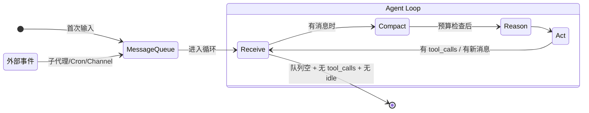
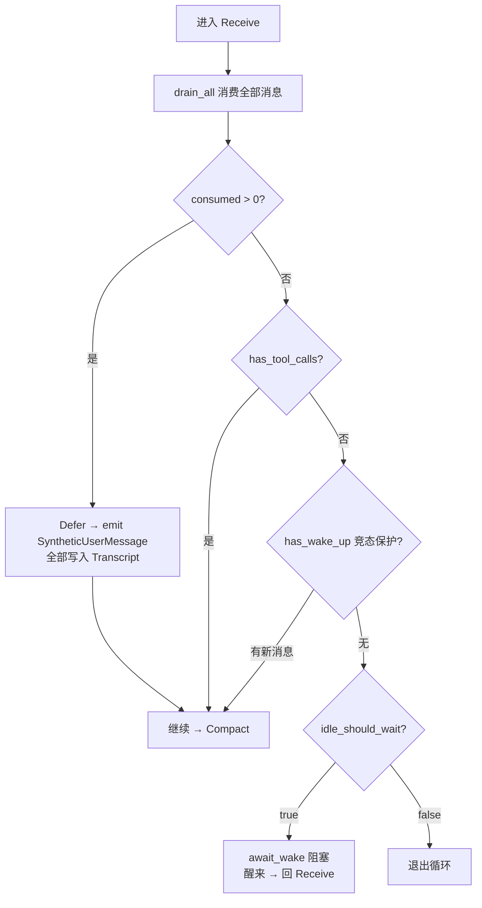
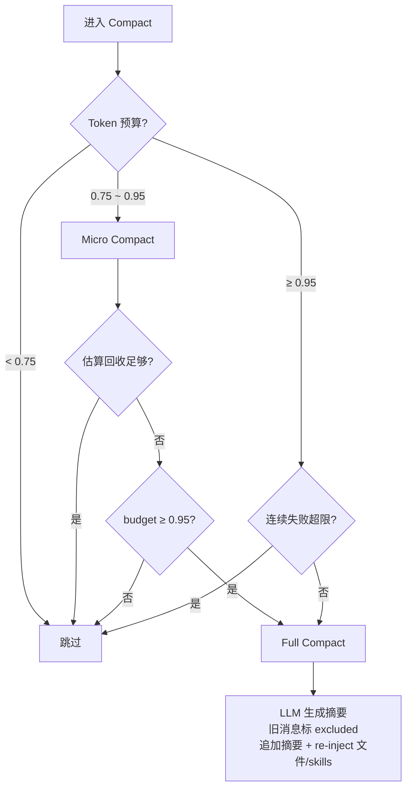
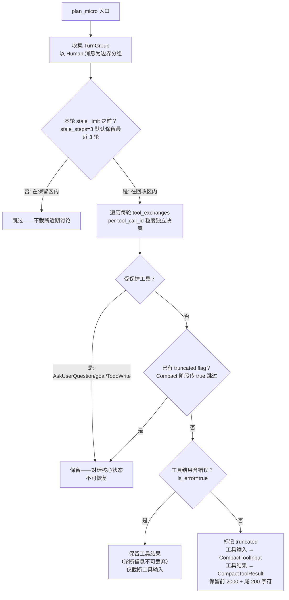
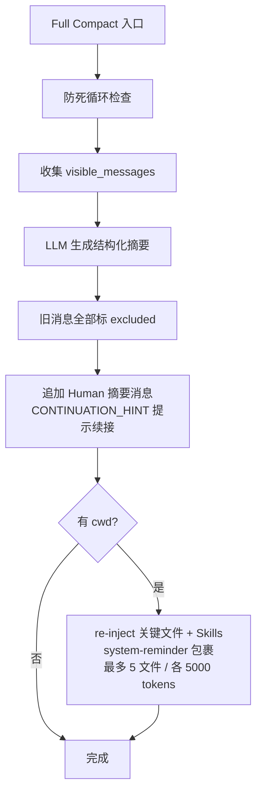
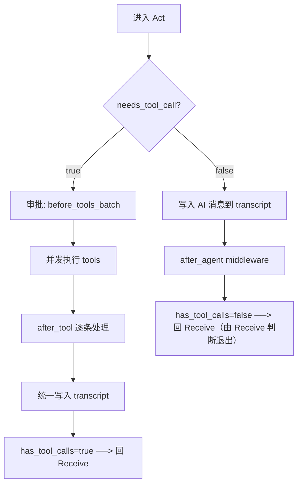
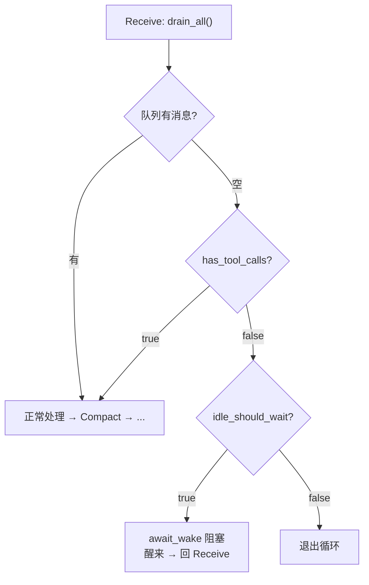
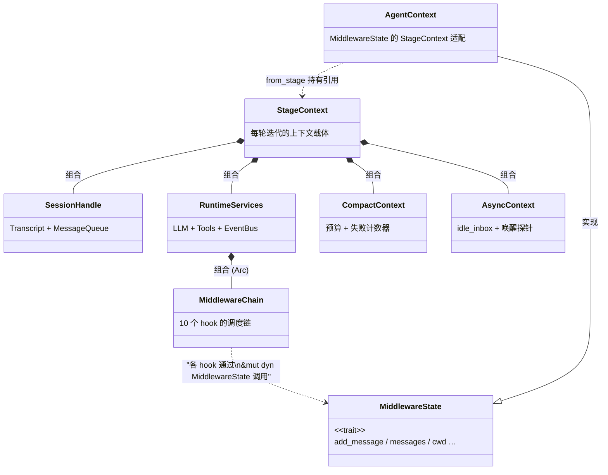

import { Aside } from '@astrojs/starlight/components';

## 概述

Agent Loop 是 Peri Agent 的核心执行模式。Agent 在循环中交替进行"思考"与"行动"——调用 LLM 推理下一步该做什么，然后分发工具执行，直到任务完成或触发上限。

```text
before_agent → loop(500 次):
  Receive → Compact → Reason → Act
     ↑                            │
     └──── 有 tool_calls / 有新消息 ──┘
     Receive 空队列 + 无 tool_calls + 无 idle → 退出
```

- **入口**：`run_react_loop(context: StageContext, max_iterations: usize)`（`peri-agent/src/agent/stages/mod.rs`）
- **上限**：500 轮迭代，防止死循环
- **退出条件**：Receive 阶段发现队列空、上一轮无工具调用、且无 idle 等待任务时退出。有 tool_calls 时继续循环——工具调用结果写入 transcript 而非队列，下一轮 Receive 通过 `has_tool_calls` 标记识别，继续让 LLM 处理工具结果。
- **RCRA 设计**：2026-07-27 从五阶段 CRRAE 简化为四阶段——Receive 合并了 End 的退出判断逻辑，Compact 移到 Receive 之后使预算判断基于完整消息集。

### 状态机总览



## 四阶段详解

### Receive — 消息接收 + 退出判断（循环入口）

Receive 是循环入口和唯一消息消费点。调用 `drain_all()` 一次性消费队列中全部消息（Prompt + Info + Defer），写入 Transcript。同时承担退出判断逻辑——队列空时检查是否该退出循环。



**三种消息消费语义**：

| 类别 | 消费阶段 | 唤醒循环 |
|------|---------|:---:|
| **Prompt** | Receive（drain_all） | ✓ |
| **Defer** | Receive（drain_all） | ✓ |
| **Info** | Receive（drain_all） | ✗ |

**退出条件三条**（缺一不可）：
1. `consumed_count == 0` —— 队列空
2. `!has_tool_calls` —— 上一轮无工具调用（工具结果在 transcript 而非队列，consumed=0 是正常状态）
3. 无 idle 等待任务 —— `idle_should_wait` 探针返回 false

**竞态保护**：退出前通过 `has_wake_up()` 再查一次队列。若退出判断期间有新消息到达，跳过退出继续循环。

**SyntheticUserMessage**：Defer 写入 transcript 前同步 emit，让 TUI bridge 刷新 committed 视图——消除 agent 状态与 UI 的时序竞争。

**idle_should_wait 探针**：检查 `active_count > 0`（未完成子代理/后台任务数）。TUI 模式返回 `Some` → await_wake 阻塞等待；stdio/print 模式返回 `None` → 直接退出。

### Compact — 上下文压缩

在 Receive 之后执行——先拉入新消息再压缩，预算判断基于完整消息集，更准确。

Compact 根据 budget 分级触发，两级策略全覆盖：



**环境变量**：`DISABLE_COMPACT` / `DISABLE_AUTO_COMPACT` 禁用自动压缩，手动触发通过 slash command `/compact`。

**中间件**：`before_compact` → compact 执行 → `after_compact`

#### Micro Compact：零 LLM 调用的智能截断

Micro Compact 是 budget 在 0.75~0.95 的主策略，不调用 LLM，仅标记消息的 `truncated` flag，零 token 开销。

**决策引擎 `plan_micro()`** 按 TurnGroup（以 Human 消息为边界）逐轮扫描：



**关键设计决策**：

| 维度 | 做法 | 理由 |
|------|------|------|
| **粒度** | per `tool_call_id`，非 per message | 同一 AI 消息中 B 工具受保护不影响 A 工具的截断 |
| **stale_steps** | 默认 3，保留最近 3 轮 | 近期讨论对当前任务最有价值 |
| **错误保留** | `is_error=true` 的工具结果不截断 | 错误信息是诊断的关键输入 |
| **受保护工具** | AskUserQuestion / goal / TodoWrite | 用户答案不可恢复，长期目标状态不可丢失 |
| **skip_existing_truncated** | Compact 阶段 `true`，Reason 阶段 `false` | Compact 阶段避免重复标记；Reason 阶段需为已标记消息生成完整投影供 LLM 查看 |

**投影渲染**：Reason 阶段 `render_llm_view` 读取 `truncated` flag + projection plan，将截断后内容渲染为 LLM 可见视图——原始 transcript 内容不变，flag 独立持久化。

**递进机制**：估算回收 token 不足且 budget ≥ 0.95 → 升级为 Full Compact。不足但未达 0.95 → 应用 Micro（部分收益也好）。

#### Full Compact：LLM 摘要与重新注入

budget ≥ 0.95 或 Micro 回收不足时触发。调用独立 LLM 生成结构化摘要，旧消息标 `excluded`，摘要以 Human 消息注入 transcript。



**摘要结构**：LLM 生成的摘要包含任务进度、关键决策、下一步方向。摘要消息以 `CONTINUATION_HINT` 结尾（`"[Context has been compacted. Continue working based on the summary above.]"`），提示 agent 上下文已被压缩。

**Re-inject 机制**：Full Compact 销毁了所有旧消息上下文，但关键文件和技能定义需要被重新注入——这些是 agent 继续工作所需的环境知识。

| 注入项 | 预算 | 机制 |
|--------|------|------|
| **关键文件** | 最多 5 文件，各 5000 tokens，总额 25000 tokens | 从旧消息提取 `Read`/`Write`/`Edit` 操作过的文件路径 |
| **Skills** | 总额 25000 tokens | 从旧消息提取 skill 加载记录 |

**防死循环**：`max_consecutive_failures` 默认 3——连续 3 次 Full Compact 失败后降级跳过，不阻止 agent 继续工作。

**无 LLM 降级**：若 LLM 不可用，Full Compact 降级为 Micro Compact（只标记 truncated，不生成摘要）。

### Reason — LLM 推理

将消息历史发送给 LLM，获取推理结果。核心流程：`before_model` 中间件 → `LLM.generate_reasoning`（与 cancel token 竞争）→ `after_model` 中间件。

**Projection 视图**：发送前通过 `render_llm_view` 将 compact plan 投影应用到消息列表——LLM 看到的已是压缩后视图。**流式桥接**：`StreamingEventBridge` 将 SSE 文本/thinking 块桥接到 EventBus，实时推送 TUI。

### Act — 工具执行

根据 Reason 结果分发：有 tool_calls 进入工具执行路径，否则产出最终回答。无论哪种路径，统一返回循环顶部 Receive。



**关键不变式**：

- **延迟写入**：工具调用消息在 dispatch_tools 内部统一写入 transcript——before_tool/after_tool 期间 transcript 不含本轮 AI 消息
- **deferred_error**：多工具并发不在中途返回，先收集所有错误再统一写入
- **error_suggest**：在 after_tool 之后、写 transcript 之前注入修复建议

**连续失败追踪**：`consecutive_failures` 原子计数器，达到 5 次时通过 StateSnapshot 通知消费方。

**中间件**：`before_tools_batch` → 并发执行 → `after_tool`（逐条） → `after_tools_batch` / `after_agent`（回答路径）

<Aside type="note">
  <strong>Receive 是唯一退出点</strong>：RCRA 重构后，Receive 合并了 End 的退出判断——Act 无论产出工具调用还是最终回答，都统一回 Receive。Receive 通过 <code>consumed_count == 0 &amp;&amp; !has_tool_calls</code> 三重条件判断是否退出。
</Aside>

### 退出逻辑（Receive 内）

RCRA 中无独立 End 阶段。退出判断发生在 Receive 顶部，三条路：



**`has_tool_calls` 保护**：工具调用结果写入 transcript 而非队列——下一轮 Receive `consumed_count==0` 是正常状态。`has_tool_calls` 标记确保多步工具链（如 Read → Edit）不被误判退出。

## 工具分发三层

Peri 采用 **三层工具分发架构**，核心思路是"常用工具始终可见，生僻工具按需加载"——减少发给 LLM 的工具列表体积，保护 prompt cache。

| 层级 | 数量 | 代表工具 | 可见性 |
|------|------|------|--------|
| **Core** | 12 个 | Read, Write, Edit, Glob, Grep, Bash, WebFetch, Agent 等 | 始终发送给 LLM |
| **Meta** | 2 个 | SearchExtraTools, ExecuteExtraTool | 始终发送给 LLM |
| **Deferred** | 动态 | Cron, MCP, LspTool, WorkflowTool, Plugin 工具 | LLM 不可见，通过 SearchExtraTools 按需发现 |

- **Core 工具**覆盖 90%+ 场景——文件读写、代码搜索、Shell 执行、Web 访问
- **Meta 工具**是延迟加载代理——LLM 先调用 `SearchExtraTools` 搜索，再用 `ExecuteExtraTool` 代理执行
- **Deferred 工具**按需注册——MCP 连接、Cron 注册、Workflow 启动时动态挂载

## 中间件桥接

v2 `StageContext` 与 v1 `MiddlewareChain` 通过 `AgentContext` 桥接：每个 hook 调用时从 StageContext 构造临时 `AgentContext`，middleware 双写 transcript + cache，调用后 drain recall 到 `ctx.recall_buffer`。

`HookMiddleware` 是中间件链的关键节点——在 `before_tool` / `after_tool` / `before_agent` / `after_agent` 处触发 28 个生命周期事件，实现工具调用审查、输出验证和安全策略注入。详见 [Hook 系统](/peri-cool/posts/engineering/hook-system/)。



**钩子发射点**：

| 钩子 | 阶段 | 时机 |
|------|------|------|
| `before_agent` | Receive 后（循环内） | 首次 Receive 消费消息后执行一次 |
| `before_compact` | Compact | compact 执行前 |
| `after_compact` | Compact | compact 执行后 |
| `before_model` | Reason | LLM 调用前 |
| `after_model` | Reason | LLM 调用后 |
| `on_error` | Reason / Act | LLM 或工具失败时 |
| `before_tools_batch` | Act（工具路径） | 工具并发执行前（含审批） |
| `after_tool` | Act（工具路径） | 每个工具执行后（含错误建议注入） |
| `after_tools_batch` | Act（工具路径） | 所有工具执行后 |
| `after_agent` | Act（回答路径） | 最终回答生成后 |

中间件链由 `MiddlewareChain` 统一管理，在 ACP 层构造（`peri-acp/src/agent/builder.rs`），顺序不可重排。v2 循环中，桥接通过 `middleware_runner.rs` 将 `StageContext` 转换为 `&mut dyn MiddlewareState` 后委托给链执行。

## 错误处理策略

每个阶段独立处理错误，不跨阶段传播：

- **Compact 失败**：`compact_consecutive_failures` 累加，达上限后降级跳过——不影响主循环
- **Reason 失败**：`on_error` middleware 先尝试恢复，无法恢复则返回 `LoopResult::Error`
- **Act 失败**（工具路径）：`deferred_error` 收集所有错误统一写入 transcript，不中断循环
- **Act 失败**（回答路径）：`on_error` middleware 尝试恢复

## 子代理同样跑 Agent Loop

`run_react_loop` 被所有类型的子代理复用，仅参数不同：

| 子代理类型 | max_iterations | 差异 |
|-----------|:---:|------|
| **Fork** | 200 | 继承 parent 的 frozen 数据，不重新读盘 |
| **Background Fork** | 200 | 异步执行，结果通过 Defer 回传 |
| **Inline** | 200 | 共享 parent 的 StageContext，直接内联 |
| **Background** | 200 | 完全独立上下文，通过 MessageQueue 通信 |

子代理的 Agent Loop 与主 agent 完全一致（四阶段 + 中间件链），区别在于上下文隔离级别和迭代上限。

## 更多资源

- [Multi Agent 架构](/peri-cool/posts/engineering/multi-agent/) — SubAgent 派发流程与生命周期
- [peri-agent README](https://github.com/konghayao/peri/blob/main/peri-agent/README.md) — Agent 框架完整文档
- [Hook 注册表设计](https://github.com/konghayao/peri/blob/main/docs/design/peri-agent-hook-registry-v2.md) — 中间件钩子全流程详解
