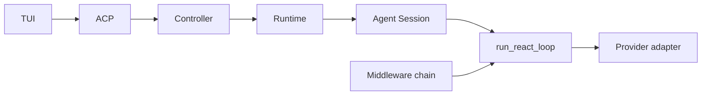
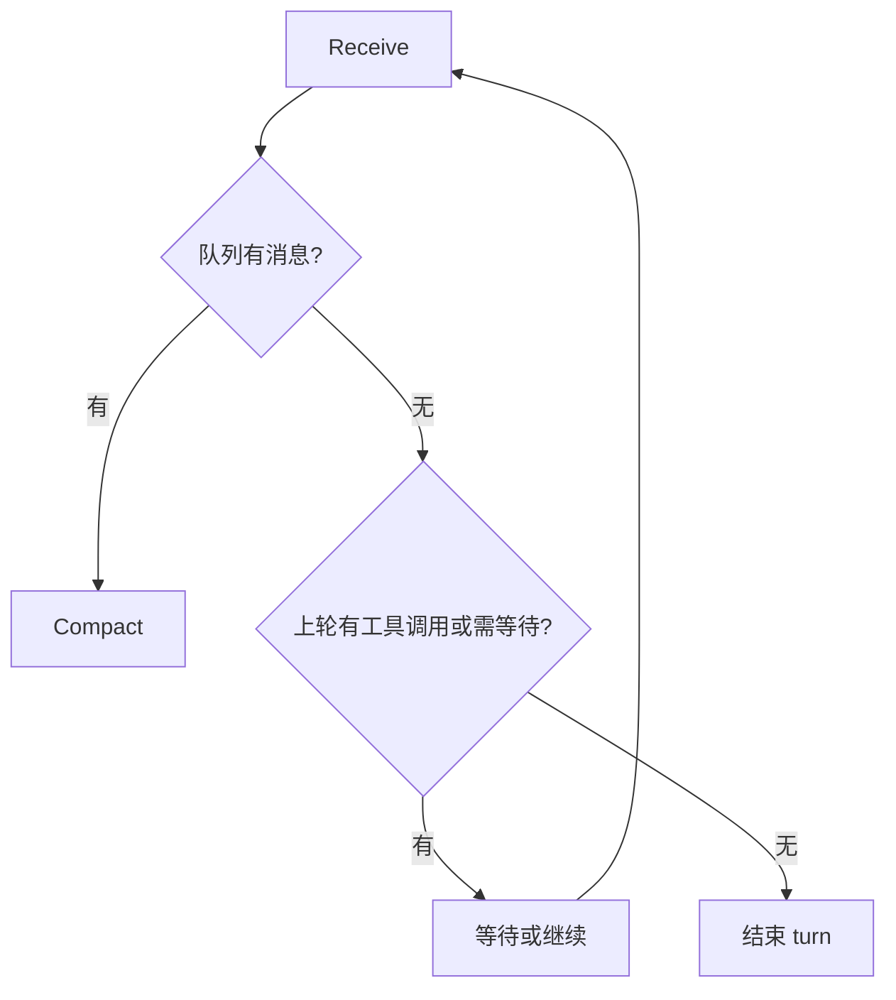
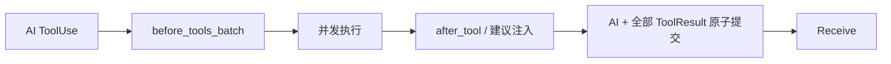

Peri 的执行核心是 RCRA：Receive → Compact → Reason → Act。它不是四个独立服务，而是
`peri-agent` 在同一 session 状态上推进的四个阶段。所有路径最终回到 Receive，由 Receive
决定继续等待、开始下一轮还是退出。

## 架构位置

TUI 负责呈现，ACP 负责协议化，Controller 与 Runtime 负责定位和编排。会话消息、执行阶段、
取消判定与最终终态归 Agent。观测读取事件，但不决定业务结果。

## Receive：唯一退出口

Receive 从 `MessageQueue` 消费 Prompt、Defer 与 Info 输入，并检查当前 turn 是否仍有待处理的
工具交换或后台唤醒条件。

cancel 的最终执行权也在 Agent。上层只定位 session、turn 与 attempt 并转发请求。默认 cancel
不等于清空待办消息；二者需要不同的显式语义。

## Compact：构造模型可见历史

Compact 不直接篡改原始消息正文。Micro planner 先以纯计算生成投影计划，再由投影函数构造
LLM 视图；应用阶段只写持久化 flags 与 projection directive。ToolUse 与 ToolResult 必须保持
配对，媒体 payload、工具参数和长结果可以按不同粒度处理。

当局部回收不足且上下文压力达到 Full 阈值时，Full Compact 用摘要替代一段可见历史，并按
预算重新注入必要文件和 Skill 信息。连续失败有降级保护，压缩失败不会被当成 Agent 成功。

机制与跨轮次恢复见 [Compact 多轮稳定](/posts/engineering/compact-multiround-stability/)。

## Reason：组装请求并调用模型

Reason 读取冻结 base prompt、当前 middleware contribution、Compact 后的消息视图和
session-local 工具定义，生成 `ModelRequest`。Provider adapter 只处理协议消息、流式事件、
重试分类与缓存 transport，不解释 Agent 的退出或任务完成语义。

流式文本、thinking、usage 和错误会转换为内部事件，再经 Runtime、Controller 与 ACP 到达客户端。
每个终止路径都必须产生可观察的 terminal 事件，否则 TUI 可能留在 loading。

## Act：执行并原子提交工具交换

有 ToolUse 时，Act 先解析目标工具并进行批量审批，再并发执行当前批次。所有调用结束后，
统一提交 AI 消息和每个 ToolResult：

成功、失败、拒绝、超时与取消都要为每个 ToolUse 留下配对结果，不能产生孤儿消息。工具执行
期间不会把半批结果暴露给下一轮模型。

没有 ToolUse 时，Act 提交最终 AI 消息，执行 `after_agent`，然后同样回到 Receive 收口退出。

## 工具可见性只有 direct 与 deferred

- **direct**：`BaseTool::is_direct() = true`，schema 直接进入当前 ModelRequest；
- **deferred**：不常驻工具数组，经 `SearchExtraTools` 发现，再由 `ExecuteExtraTool` 执行。

“Core”可以作为对高频工具的口语称呼，但不是运行时白名单。实际集合从当前 session 的
middleware chain、配置与 Agent filter 派生。MCP、Workflow、LSP、Plugin 等能力是否
可搜索，最终也由同一工具视图决定。

包装调用不能改变权限事实。审批、事件和工具卡片应按 effective target 处理，不能因为外层
名字是 `ExecuteExtraTool` 就跳过真实工具边界。

## Middleware 链的所有权

生产顺序由 `peri-agent/src/session/factory.rs::production_blueprint` 定义，具体组件由
`peri-middlewares/src/assembly.rs` 构造。顺序影响段落贡献、工具注册、审批与生命周期 Hook，
因此属于行为契约，不能按名称排序或在另一层复制清单。

每次模型请求前，中间件可以提供 request-time contribution；这些文本追加在 frozen base prompt
之后，不进入 Transcript。Meta Harness 关闭一个 middleware 时，它的工具、段落和 Hook 应形成
同一个能力闭包。

## SubAgent 与 Workflow 复用执行体

SubAgent 拥有独立 Transcript 和工具视图，并继承父会话冻结的 owner snapshot。Workflow 的
`agent()` 也落到同一 Agent 执行体，只是调用序列由脚本与 runner 编排。

复用循环不等于复用全部能力。named agent 定义、allowlist/disallowlist、Meta Harness、Workflow
宿主和当前 session 能力都会裁剪最终工具面。

## 验证边界

- 阶段测试证明单个状态转换；
- Transcript 测试证明 ToolUse/ToolResult 配对与持久化；
- middleware assembly 测试证明链序和能力 presence/absence；
- ACP mapper 与 TUI 测试证明事件真正到达客户端；
- Provider adapter 测试证明 wire 序列化与 cache seam。

<Aside type="note">
  单个 mapper 测试不能证明整条界面链路，模型回复也不能证明内部状态机正确。跨层修改需要沿
  Agent 发射、Runtime/Controller 路由、ACP 映射和 TUI 消费逐层验证。
</Aside>

相关内容：[系统提示词](/posts/engineering/system-prompt/) · [Hook 与 Middleware](/posts/engineering/hook-middleware-overview/) · [Dynamic Workflow](/posts/engineering/workflow-design/)
