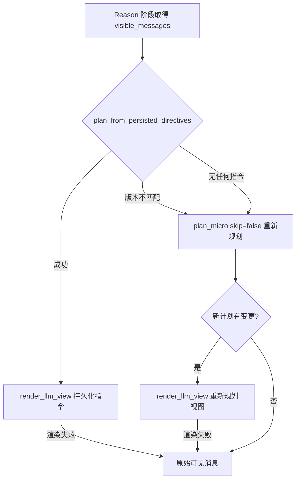

import { Aside } from '@astrojs/starlight/components';

[Agent Loop](/peri-cool/posts/engineering/agent-loop/) 解释了 Compact 的触发规则和模型视图。本稿讨论另一个问题：Compact 不是一次性动作。长会话里它在每一轮都可能触发，会话结束后还可能跨进程恢复。**多次触发、跨会话恢复之后，模型看到的视图必须保持一致**——否则同一段历史，上一轮压缩后的截断效果在这一轮生效，下一轮又变回原样。

多轮稳定依赖三个能跨轮次存活的东西：

1. **Compact 标记**：记录消息被排除（`excluded`）还是被截断（`truncated`）。
2. **投影指令（projection directive）**：记录每条被截断消息的精确压缩方案。
3. **消息标识**：把正文、标记、指令重新对应起来的键。

三者按同一个 `message_id` 装配。装配发生的位置有两个：每一轮进入推理之前，以及会话恢复时。

<Aside type="note" title="术语">
    本篇把「标记」与「投影指令」分开说。标记只回答"这条消息要不要在模型视图里被换掉"，投影指令回答"换成什么样子"。两者都挂在每条消息的 flags 上。
</Aside>

## 标记代替删除，正文不动

Compact v2 的设计原则是标记代替删除：不修改消息本体，旧消息由 `visible_messages()` 按标记自动过滤或投影。`MessageFlags` 承载三个相关字段：

| 字段 | 含义 | 写入方 |
| --- | --- | --- |
| `truncated` | Micro 截断该消息 | micro 应用层 |
| `excluded` | Full Compact 排除该消息 | full 应用层 |
| `projection` | 该消息的投影指令（`policy_version` + entries） | micro 应用层 |

关键细节：投影指令里每个 entry 都带 `message_id`。指令不是散装的字符串，它和消息正文靠同一个标识对应。Micro 应用层按 `message_id` 把 action 分组，为每条消息生成独立的 `MessageProjectionDirective`，写入 flags 时同时设置 `truncated`。正文全文保留在存储里，模型看到的截断视图在渲染时由指令重建。

## 四层分工：写标记的只有一个出口

| 层 | 位置 | 职责 | 副作用 |
| --- | --- | --- | --- |
| trigger | `mod.rs` 的 `run_compact` / `determine_compact_action` | 按 budget 判定策略、执行、统计 | 调用应用层 |
| planner | `planner.rs` 的 `plan_micro` | 只读扫描 transcript，生成投影计划 | 禁止写 flags |
| projection | `projection.rs` | 从持久化指令重建计划、渲染 LLM 视图 | 无（纯函数） |
| mutate | `micro.rs` 的 `micro_compact` | 把计划写成 per-message 投影指令 | 唯一写标记的出口 |
| config | `CompactConfig` | 阈值与排除规则 | 无 |

planner 的文档注释写死了约束：只能读 `MessageTranscript` 和 `CompactConfig`，绝不能调用 `set_truncated`、`set_excluded`、持久化或 provider。projection 的 `render_llm_view` 是不触碰 transcript 的纯函数。这样无论 trigger 跑多少轮，修改 transcript 的只有 mutate 一个出口——这是视图可重复的前提。

## 配置层决定"何时动、动哪里"

`CompactConfig` 是纯数据契约。`auto_compact_threshold` 在反序列化时会 clamp 到 `[0.0, 1.0]` 并告警，防止配置错误导致 Full 升级路径被静默绕过。以下默认值来自源码：

| 配置项 | 默认值 | 作用 |
| --- | --- | --- |
| `micro_compact_threshold` | 0.75 | budget 达到它才进入 Micro |
| `auto_compact_threshold` | 0.95 | Micro 回收不足且达到它时叠加 Full |
| `micro_compact_stale_steps` | 3 | 最近 3 轮不截断 |
| `micro_excluded_tools` | Agent / AskUserQuestion / goal / TodoWrite | 这些工具的输入输出整体保留 |
| `micro_field_threshold_chars` | 500 | 单字段超过它才截断 |
| `micro_field_keep_head_chars` / `keep_tail` | 350 / 100 | 截断时保留的头尾字符数 |
| `max_consecutive_failures` | 3 | 连续失败超限后降级跳过 |

`smart_compact_enabled` 已标记废弃，运行时按关闭处理；当前实际策略就是 Micro + Full 两级，Smart 路径仅保留兼容分支和测试。

## 多轮触发：增量截断，不重复不回退

每一轮 Compact 阶段都会重新执行 `plan_micro`，但传入 `skip_existing_truncated=true`：已经标过 `truncated` 且指令版本一致的消息直接跳过。因此：

- 第 N 轮只处理第 N 轮之前尚未被处理的消息，是增量截断；
- 已持久化的旧截断保持不变，新轮次不会把它们改回去；
- `stale_steps=3` 把最近 3 轮挡在回收区外，截断只发生在讨论已稳定的历史里。

效果上，多轮 Compact 像一个只前不退的快照序列：每轮在旧截断的基础上向前推进，而不是重新洗牌。

## Reason 阶段：视图一致靠持久化指令，不靠每轮重新规划

每个轮次进入 LLM 推理前，Reason 阶段按固定顺序选择可见消息的来源：

主路径是第一个分支：只要标记和指令还在，模型每轮看到的是同一个投影视图，不重新规划。指令重建时会做两类校验：

- 指令的 `policy_version` 必须等于当前投影策略版本（`PROJECTION_POLICY_VERSION`，当前为 2），不匹配直接报 `DIRECTIVE_VERSION_MISMATCH`；
- 指令 entry 的 `message_id` 必须等于当前消息 id，错位即 fail-closed。

消息被标 `truncated` 却没有任何指令时，返回 `CORRUPTED_PROJECTION` 而不是猜测兜底。另外，指令里固化了下手时的 `keep_head` / `keep_tail`，所以之后配置再改，也不影响已持久化指令渲染出的样子。

## 跨会话恢复：标记与正文一起回来

会话恢复时，先装入消息正文，再按阶段从存储读回 flags，用 `message_id` 批量装回 transcript。标记和指令与正文同一条标识对应，新会话直接走上文的主路径。

标记加载失败会记录诊断并继续运行——让整个会话打不开会扩大存储故障的影响。此时没有可用指令，Reason 阶段会落到重新规划分支。这里要说明白：**重新规划是重建，不是还原**。标记丢失时，模型视图不会和关闭前完全相同，缺失层的降级结果是可观察的差异，不是无损恢复。

## Full Compact 的多轮状态切换

Full Compact 是另一种状态切换，不是下一轮的障碍：全部旧消息标 `excluded`，`visible_messages()` 自动过滤；追加一条带 `CONTINUATION_HINT` 的摘要 Human 消息；随后按预算 re-inject 最近读取的文件与 Skill 定义。`excluded` 同样持久化，后续轮次不再处理这些历史。

失败语义也在多轮视角下成立：budget 高位时先应用 Micro 再叠加 Full；Full 失败时代码对外报 `MicroAppliedThenFullFailed`，但 Micro 的截断标记已经持久化——这一轮的压缩收益不会因为 Full 失败而丢掉，下一轮从同样的状态继续。`max_consecutive_failures`（默认 3）兜底防死循环：连续失败超限后跳过压缩，不阻塞主循环。

## 测试固定这些边界

- `trigger_test.rs` 固定触发判定、回收不足升级、失败上限、shadow mode；
- `projection_test.rs` 固定指令重建的空指令、版本不匹配、旧数据无指令直通、stale config 仍渲染等分支；
- `transcript_test.rs` 固定投影指令的持久化 roundtrip；
- Micro 集成测试固定"标志写入后恢复一致、多轮后旧标记保留、首次运行不清理标记"。

这些用例共同兜住一个承诺：标记和指令一旦写入，任一后续轮次或恢复后的新会话都能重建并渲染出同一视图。

## 适用边界

- **没有实测数据**：截断实际节省的 token 百分比没有发布过数字，估计函数是字符数除以 4 的粗估；可引用的只有上表的配置默认值。
- **这不是无损压缩**：投影会移除 Image/Document 的 Base64 payload，Full 更是用摘要代替原文。
- **Provider 能力参与渲染**：比如带签名的 reasoning 在部分 Provider 协议下必须整体保留；换 Provider 后，旧指令可能渲染出不同的视图。
- **降级路径只保证可用，不保证一致**：标记缺失或版本不匹配时的重新规划是近似重建，跨 Provider、跨配置修改时同样如此。

## 下一步

- [Agent Loop](/peri-cool/posts/engineering/agent-loop/)：Compact 的触发规则与两级策略
- [中断长任务的恢复边界](/peri-cool/posts/engineering/rcra-interruption-recovery/)：恢复时从版本控制、测试输出与工作流记录核对状态
- [工具交换的原子提交](/peri-cool/posts/engineering/concurrent-tool-calls/)：长会话里另一类与轮次相关的边界