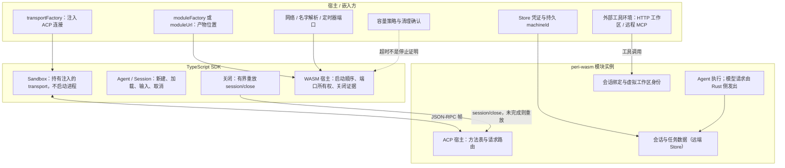

把 Peri 装进别的运行时，首先要接受一条边界：**SDK 不替你管进程**。

它给出的东西只有三样。

1. **一个必须注入的传输层**：ACP 连接由宿主提供，缺失就在构造时失败。
2. **一个有界重放的关闭路径**：关闭会话只重放会话关闭请求，预算耗尽后抛出明确的未完成错误。
3. **一份诚实的回报**：关闭未完成就是未完成，不把超时当作已经停止。

进程、端口、容量、凭证都在宿主侧。下面逐条说明这三样契约，以及 WASM 形态下宿主需要准备什么。

## 契约一：进程不在 SDK 手里

v4 的 SDK 边界声明删除了全部进程控制能力，并且不留别名或兼容层。

1. **没有启动进程的 API**：没有 stdio 传输、没有工作区进程管理、没有本机进程停止证明。
2. **没有进程句柄**：SDK 不返回 PID，也不提供进程组停止证明。
3. **没有本地注册表与本地库**：本地 SQLite 存储与 JSONL 派发器一并删除，会话数据经远端 Store。
4. **反过来的推论不成立**：「SDK 不替你管进程」不等于「Peri 不能跑在服务端」。证据支持的结论只是：服务端上的进程、端口与容量由嵌入方拥有。

## 契约二：transport 是必填注入点

传输层是构造参数，不是可选项。

```ts
import { Sandbox } from "@peri-code/sdk";

// hostTransport 由宿主实现：它可以连本地进程、连远端服务，或接 WASM 宿主。
const sandbox = new Sandbox({
  transportFactory: (path) => hostTransport(path),
  // 其余能力（凭证、Store 位置）也由调用方显式提供。
});
```

1. **缺参数即失败**：构造时校验，传进来的不是函数就抛出「transportFactory is required」。
2. **路径原样转发**：SDK 不对路径做本机解析，因为路径属于远端工具环境，不属于本机文件系统。
3. **身份与执行所有权是两件事**：SDK 不会把沙箱 ID 当作机器身份传给 Peri。
4. **不读宿主环境**：凭证与 Store 位置由调用方显式传入，SDK 不读环境变量，也没有命令行参数或环境变量回退。

## 契约三：关闭只重放会话关闭

关闭会话与断开连接是两件事。

1. **关闭会话发一条请求**：`session/close`，带上会话 ID。
2. **只有一种错误码被当作可重试的未完成**，其余错误原样抛出，不包装。
3. **重放有节奏也有预算**：默认预算 3 秒，期间按固定间隔重放；预算显式设为 0 表示只尝试一次。
4. **预算是显式的**：负数或非安全整数直接抛类型错误，不会静默取默认值。
5. **二次关闭是空操作**：已经关闭的会话再关闭不发请求；并发调用共享同一次操作。
6. **直接关传输层不算关闭会话**：只断开连接会留下未结算的宿主，这是使用 SDK 时最容易踩的一处。

## 关闭未完成是一个诚实错误

预算耗尽而宿主仍报未完成时，SDK 抛出 `SessionCloseIncompleteError`。

1. **错误的含义是「宿主尚未结算」**，不是「进程还活着」，也不是「进程已停止」。
2. **未完成时保留状态**：未完成时 SDK 不关传输层、不释放占用，会话保持未关闭，允许再次调用关闭重试。
3. **两类原因都会被保留**：如果一次未完成之后又出现新的失败，错误里同时携带两个原因。
4. **宿主为什么报未完成**：常见原因包括存储结算未知、关闭意图未持久化确认、独立子代理尚未交接、当前一轮请求仍在执行、任务与资源尚未收尾。
5. **活跃轮次会让关闭一直未完成**：正在生成的会话应先取消，再关闭。

## 宿主职责清单

WASM 形态下，启动对象有四件事必须由宿主提供，且每一项都有语义。

| 项 | 宿主必须提供 | 关键约束 |
| --- | --- | --- |
| `cwd` | 虚拟文件系统中的绝对路径 | 模块会建立同名空目录并规范化 |
| `settings` | 整份配置文档 | 与 stdio 启动同构，会替换 Peri 全局配置 |
| `storage` | Store 地址与凭证来源 | 写打开直接连远端 Store |
| `machineId` | 持久化的 UUID 执行身份 | 缺失即拒绝写共享 Store |

除此之外还有三项。

1. **模块加载入口二选一**：给产物 URL，或给静态导入的模块工厂。
2. **三个平台端口归宿主**：网络、名字解析、定时器各一个端口，关闭语义各自定义，清理完成时间由宿主负责。
3. **容量策略在宿主侧**：宿主必须检查启动失败的清理结果与延迟清理结果，确认结算后才能复用容量；**超时不构成停止证明**。

workerd 类宿主只能走模块工厂这条路，因为打包后的模块没有可用的产物 URL；这种情况下缺少工厂会报可操作的错误，而不是底层的类型错误。



## WASM 里跑得了什么、跑不了什么

1. **能跑的**：ACP 方法表、Agent 执行循环、模型请求（由 Rust 侧发出）、远端 Store 的会话与归属数据。
2. **宿主注入的**：传输层、网络、名字解析、定时器、遥测凭证（JS 宿主的环境变量不会自动传到 Rust 侧）。
3. **跑不了的**：宿主项目文件系统、任意 shell 与子进程、本地内置 MCP 服务、命令型 Hook（会明确报错，不静默放行）。
4. **本机模式直接失败**：WASM 下给本机库地址会直接报错，不静默落回本地存储。
5. **虚拟工作区不等于真实文件系统**：路径与文件事实不被校验，工作区文件工具必须由外部 MCP 提供。
6. **普通浏览器不能直接走这条路**：这条链路依赖 Node 风格的网络与 DNS 端口，浏览器直接运行不成立。
7. **一个模块实例只承载一个机器身份**：多机器必须隔离成多个实例；同一实例内变更身份会被确定拒绝。
8. **旧格式的 WASM 会话可以读历史，但不能恢复执行**：需要新建会话。
9. **实时投影不是权威**：进程内的会话文档投影是实时视图，重启后应重新启动会话，从 ACP 历史重建。

## 验收现状

**已经验收的**

1. 宿主形态：Node、Bun、本地 `workerd`，均为「一个宿主一个模块实例」。
2. WASM 真实链路：打包后的模块加真实远端 Store，配合模拟模型端点，覆盖发送、撤回、取消、关闭、加载与遥测。
3. 本地 workerd 的 ACP 方法表探测，四条路径中有三条以有界关闭收尾。
4. SDK 契约行为：关闭重放、预算、错误保留与占用释放、端口所有权与清理。
5. 应用层端到端：登录、多轮回答、同步、刷新历史、停止后继续、移动端布局。

**尚未验收的**

1. 托管部署：生产端点、资源限制与托管环境下的 SDK 入口都没有验收。
2. 真实模型端点与真实远端存储的端到端通过记录。
3. 平台限制在真实套餐下的表现：打包体积、CPU、内存与连接数。
4. 跨实例接管、长任务续跑与生产崩溃恢复。
5. 执行准入与精确停止协议：协议侧目前没有对应方法。
6. 多租户隔离：当前的应用令牌只代表一个共享信任域。
7. 稳定性复跑：真实配置完整跑通过一轮，但连续复跑仍有存储 I/O 间歇失败，不能宣称稳定可用。

## 边界

1. **契约不等于运行时**：SDK 给的是注入点、协议契约与关闭证据，不是一套替你运行服务的东西。
2. **关闭不等于停止**：关闭成功只表示宿主完成结算；超时与未确认都不代表执行已经停止。
3. **就绪不等于停止证明**：只有关闭事件才是证明，且超时不构成证明。
4. **身份不是凭证**：机器身份是归属标签，不是认证凭证、租约或工具权限；相同的身份加相同的根路径会得到同一个工作区身份。
5. **只读不假装可写**：WASM 形态下本机模式直接失败，不会静默降级。
6. **休眠恢复不等于计算接管**：存储持久化不代表在途计算可恢复。
7. **遥测是旁路**：遥测上报失败属于诊断旁路，不能把业务成功当成上报成功。
8. **示例不是生产服务**：仓库中的应用示例是单可信用户示例，不是已完成生产验证的服务。

## 相关实现

- SDK 边界与用法：`npm-packages/@peri-sdk/README.md`
- 代码索引：`docs/code-index/peri-ts-sdk.md`、`docs/code-index/peri-wasm.md`、`docs/code-index/peri-cf.md`
- 沙箱与关闭：`npm-packages/@peri-sdk/src/sandbox/sandbox.ts`、`npm-packages/@peri-sdk/src/agent/session-close.ts`
- WASM 宿主与端口：`npm-packages/@peri-sdk/src/wasm/host.ts`、`npm-packages/@peri-sdk/src/wasm/ports.ts`
- 服务端身份设计：`docs/design/serverless-execution-identity.md`
