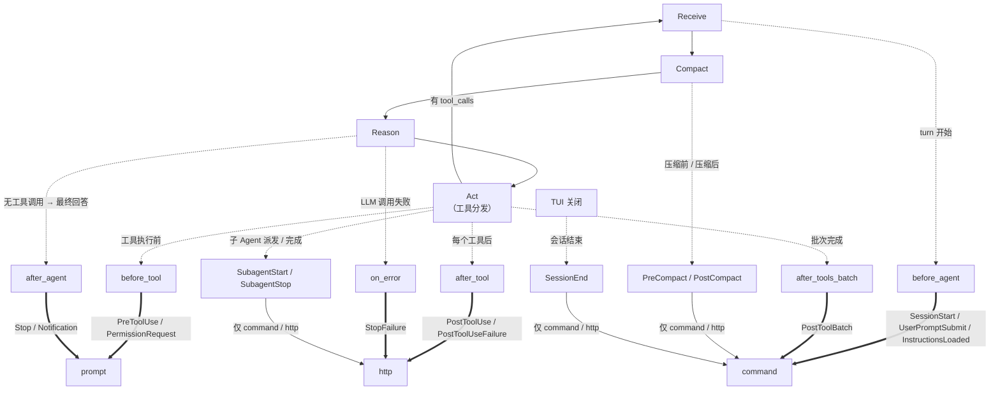
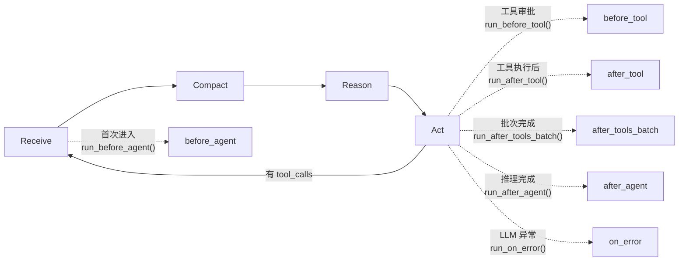
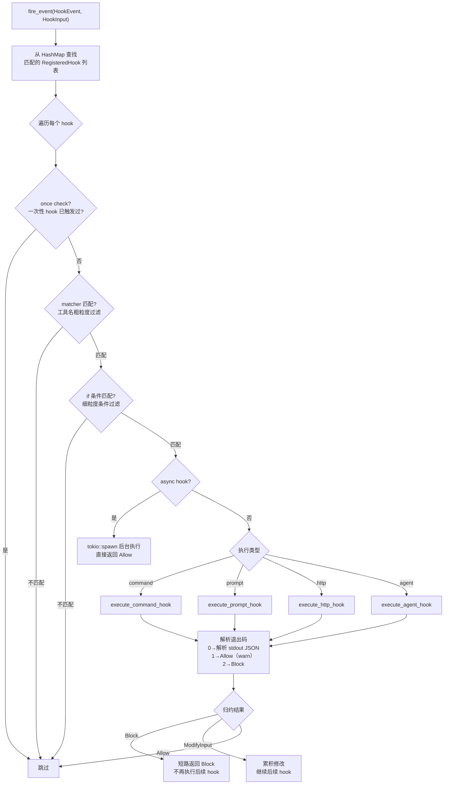
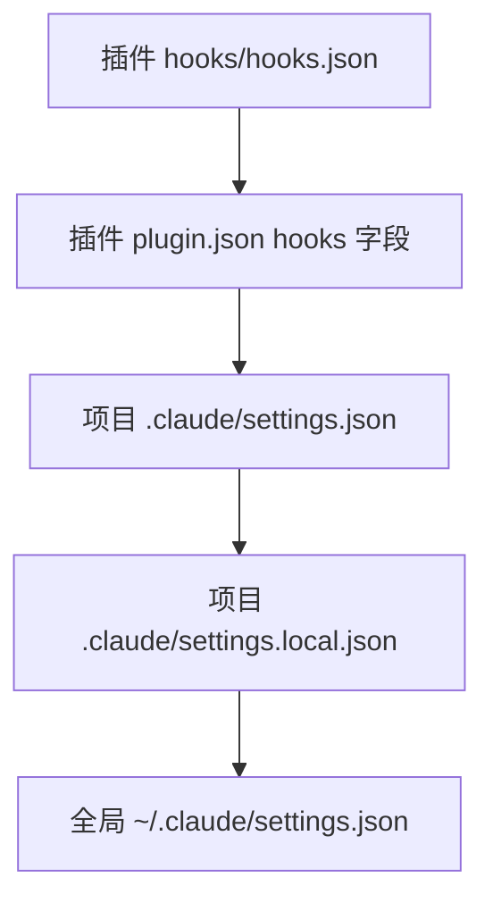
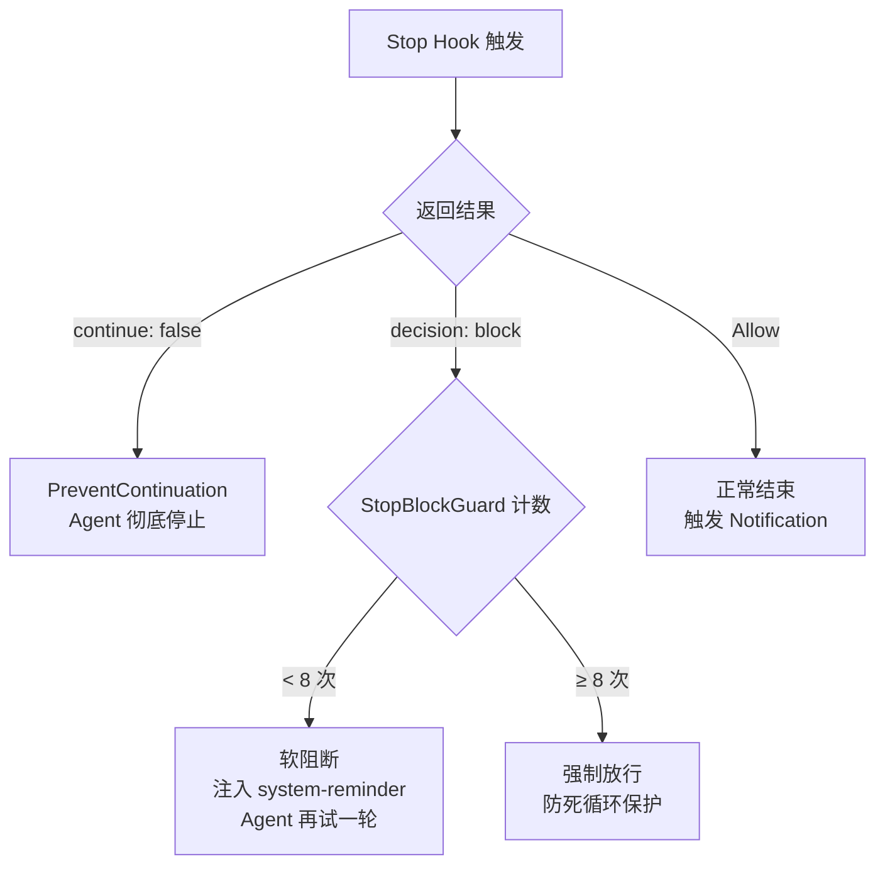

import { Aside, Tabs, TabItem } from '@astrojs/starlight/components';

## 完整架构：三层管道

Peri 的 Hook 系统是一条**三层管道**——每层职责清晰，数据单向流动：



三层职责一句话：

| 层 | 职责 | 可扩展性 |
|---|------|:---:|
| **Layer 0：Agent Loop** | RCRA 循环在固定位置调用 Middleware trait 方法，决定"**什么时候触发**" | 改动需修改 Rust 代码 |
| **Layer 1：Hook Middleware** | 将 Agent Loop 的 6 个生命周期方法映射到 15 个 Claude Code 事件，决定"**触发什么事件**" | 新增事件需修改 Rust 代码 |
| **Layer 2：Claude Code Hook 分发** | 加载用户配置的 hook 规则，执行 command/prompt/http/agent，返回 Allow/Block/ModifyInput，决定"**怎么响应事件**" | **纯配置驱动，无需改代码** |

<Aside type="note">
Hook 系统完全兼容 **Claude Code Hook 规范**——事件命名、配置格式、退出码语义和输出结构均与 Claude Code 对齐。从 Claude Code 迁移的 hook 配置文件可直接使用。
</Aside>

## Layer 0：Agent Loop 如何驱动 Hook

Agent Loop 是 RCRA 四阶段循环（详见 [Agent Loop 文档](/peri-cool/posts/engineering/agent-loop/)）。每次循环在固定的生命周期节点调用中间件链的对应方法：



`MiddlewareChain` 按注册顺序遍历链上所有中间件（HookMiddleware 是其中之一），依次调用对应方法。Hook 的返回结果（Allow/Block/ModifyInput/PreventContinuation）会反向传递，影响 Agent Loop 的后续行为。

## Layer 1：Hook Middleware — 6 个 trait 方法 → 15 个事件

`HookMiddleware`（`peri-middlewares/src/hooks/middleware.rs`）是 Layer 1 的唯一实现，通过 `#[async_trait] impl Middleware` 提供 6 个生命周期方法。每个方法内部调用 `HookDispatcher::fire_event()`，将内部生命周期映射为用户可见的 Claude Code 事件。

### 逐方法映射表

| Middleware 方法 | Loop 触发时机 | 触发的 Claude Code 事件 |
|-----------|----------|------|
| `before_agent` | 每轮循环首次进入 | `SessionStart`（仅首次有 source）→ `UserPromptSubmit` → `InstructionsLoaded` |
| `before_tool` | 每个工具执行前 | `PreToolUse` → `PermissionRequest`（仅敏感工具+弹窗模式） |
| `after_tool` | 每个工具执行后 | `PostToolUse`（成功）/ `PostToolUseFailure`（失败） |
| `after_tools_batch` | 一批并行工具全部完成 | `PostToolBatch` |
| `after_agent` | Agent 输出最终回答 | `Stop` → `Notification` |
| `on_error` | LLM 调用失败 | `StopFailure` |

### Standalone 事件：不走 Middleware trait 的触发路径

除了上述 15 个通过 Middleware trait 触发的事件外，还有一组 **Standalone 事件**——它们在 Agent Loop 之外由特定模块直接调用 `fire_standalone_lifecycle_hooks()` 触发：

| 事件 | 触发模块 | 触发时机 |
|------|---------|----------|
| `SubagentStart` | SubAgent 工具 | 子 Agent 派发时 |
| `SubagentStop` | SubAgent 工具 | 子 Agent 完成时 |
| `PreCompact` | Compact 阶段 | 上下文压缩前 |
| `PostCompact` | Compact 阶段 | 上下文压缩后 |
| `SessionEnd` | TUI 关闭 | /clear 等会话重置时 |

<Aside type="caution">
Standalone 路径没有 LLM factory，因此 **Prompt / Agent 类型的 hook** 在这些事件上被跳过，仅支持 command / http 类型。
</Aside>

## Layer 2：Claude Code Hook 分发 — HookDispatcher

`HookDispatcher`（`peri-middlewares/src/hooks/dispatcher.rs`）是 Layer 2 的核心引擎。`fire_event()` 的执行流程如下：



### 过滤机制：matcher + if 两级

| 层级 | 字段 | 语法 | 示例 |
|------|------|------|------|
| 粗粒度 | `matcher` | `*` / `A\|B` / 正则 | `"Bash\|Write\|Edit"` |
| 细粒度 | `if` | 权限规则语法 | `"Bash(git commit)"` |

两条都匹配时才执行 hook。matcher 在锁外快速跳过不相关工具，if 在锁内做精确匹配。

## 一个完整 turn 的 Hook 事件时序

```mermaid
sequenceDiagram
    participant Loop as Agent Loop
    participant Chain as MiddlewareChain
    participant MW as HookMiddleware<br/>(Layer 1)
    participant CC as HookDispatcher<br/>(Layer 2 → 用户 hook)

    Loop->>Chain: 进入循环
    Chain->>MW: before_agent()
    MW->>CC: fire_event(SessionStart)
    MW->>CC: fire_event(UserPromptSubmit)
    MW->>CC: fire_event(InstructionsLoaded)

    Loop->>Chain: Act（工具执行开始）
    Chain->>MW: before_tool()
    MW->>CC: fire_event(PreToolUse)
    MW->>CC: fire_event(PermissionRequest)
    Note over MW,CC: 用户 hook 可返回<br/>Allow / Block / ModifyInput

    Loop->>Loop: 执行单个工具
    Chain->>MW: after_tool()
    MW->>CC: fire_event(PostToolUse / PostToolUseFailure)

    Note over Loop,CC: 重复 before_tool → after_tool 直到所有工具完成

    Chain->>MW: after_tools_batch()
    MW->>CC: fire_event(PostToolBatch)

    Note over Loop,CC: 或无工具调用，直接进入回答

    Chain->>MW: after_agent()
    MW->>CC: fire_event(Stop)
    Note over MW,CC: Stop hook 可返回<br/>PreventContinuation 阻断 Agent
    MW->>CC: fire_event(Notification)
```

## 完整事件体系

Peri 实现了 **15 个核心事件**（已生产验证，通过 Middleware trait 触发）和 13 个扩展事件（基础设施就绪，含 5 个 Standalone 已接入事件 + 8 个待接入触发点），共计 28 个事件。

### 核心事件表（Middleware trait 触发）

| 事件 | 触发阶段 | 说明 |
|------|---------|------|
| **SessionStart** | before_agent | 会话首次启动（source: startup / resume / clear / compact） |
| **UserPromptSubmit** | before_agent | 用户每次发送消息 |
| **InstructionsLoaded** | before_agent | 系统提示词加载完成 |
| **PreToolUse** | before_tool | 工具执行前，可改写输入 |
| **PermissionRequest** | before_tool | 权限弹窗前（仅敏感工具 + 弹窗模式） |
| **PostToolUse** | after_tool | 工具执行成功 |
| **PostToolUseFailure** | after_tool | 工具执行失败 |
| **PostToolBatch** | after_tools_batch | 批次完成 |
| **Stop** | after_agent | 推理完成，可阻断续跑 |
| **StopFailure** | on_error | LLM 调用失败 |
| **Notification** | after_agent / before_tool | Agent 等待用户时 |

### Standalone 事件（外部触发）

| 事件 | 触发源 | 说明 |
|------|--------|------|
| **SubagentStart** | SubAgent 工具 | 子 Agent 启动 |
| **SubagentStop** | SubAgent 工具 | 子 Agent 结束 |
| **PreCompact** | Compact 阶段 | 上下文压缩前 |
| **PostCompact** | Compact 阶段 | 上下文压缩后 |
| **SessionEnd** | TUI 关闭 | /clear 等会话重置时 |

## Hook 类型

Peri 支持 4 种 Hook 执行类型，通过 JSON 的 `type` 字段区分：

<Tabs>
<TabItem label="command">

Shell 命令执行——最常用的类型。

```json
{
  "type": "command",
  "command": "node scripts/validate.sh",
  "timeout": 600,
  "once": false
}
```

- stdin 接收完整的 `HookInput` JSON
- 退出码 0 → 解析 stdout 为结构化决策（Allow / Block / ModifyInput）
- 退出码 1 → Allow（warn），退出码 2 → Block
- 超时 → Allow（fail-open 原则）

</TabItem>
<TabItem label="prompt">

LLM 评估——调用独立 LLM 做决策。

```json
{
  "type": "prompt",
  "prompt": "评估以下工具调用是否安全：$ARGUMENTS",
  "timeout": 30
}
```

- `$ARGUMENTS` 替换为 HookInput JSON
- 1 轮无工具 LLM 调用评估
- 输出经结构化解析
- 仅在 Middleware trait 路径可用（有 LLM factory），Standalone 路径跳过

</TabItem>
<TabItem label="http">

HTTP POST——与外部服务集成。

```json
{
  "type": "http",
  "url": "https://api.example.com/hook",
  "timeout": 600,
  "headers": { "Authorization": "Bearer ${TOKEN}" },
  "allowed_env_vars": ["TOKEN"]
}
```

- POST HookInput JSON body
- SSRF 防护：阻止私有网络（10.x / 172.16.x / 192.168.x），允许 loopback
- 环境变量白名单展开

</TabItem>
<TabItem label="agent">

子 Agent 评估——Peri 特有扩展。

```json
{
  "type": "agent",
  "prompt": "分析当前场景并返回 JSON 决策",
  "timeout": 60
}
```

- 1 轮无工具 LLM 调用
- Claude Code 无此类，Peri 新增
- 仅在 Middleware trait 路径可用（有 LLM factory），Standalone 路径跳过

</TabItem>
</Tabs>

## 配置方式

Hook 配置遵循 Claude Code 格式，从多个来源加载，按优先级**从低到高**覆盖：



### 配置结构

```json
{
  "hooks": {
    "PreToolUse": [
      {
        "matcher": "Bash|Write|Edit",
        "hooks": [
          {
            "type": "command",
            "command": "python3 audit.py",
            "timeout": 30,
            "status_message": "审计中…"
          }
        ]
      }
    ],
    "SessionStart": [
      {
        "hooks": [
          {
            "type": "command",
            "command": "echo '会话已启动'",
            "once": true
          }
        ]
      }
    ]
  }
}
```

每个事件名下是一个 hook 组数组。一个 hook 组由 `matcher`（工具名粗粒度过滤）、`if`（细粒度条件过滤）和 `hooks`（实际执行的 hook 列表）组成。同组内的 hook 串行执行，遇到 Block 时短路。

## Stop Hook 与防死循环

`Stop` 事件是唯一可以阻断 Agent 继续执行的 hook——允许外部审查 Agent 的最终回答，决定是否通过或要求重试。

### 决策模型



**连续 Block 上限为 8 次**——超过后强制放行，防止 Stop hook 规则过严导致 Agent 永远无法结束。

<Aside type="caution">
Block 的重试反馈以 `Human` + `<system-reminder>` 标签形式注入，禁止使用 `BaseMessage::system()`。因为 Anthropic / OpenAI 的 invoke API 会将 System 消息 hoist 到 system prompt 顶部，破坏 `frozen_system_prompt` 的稳定性。
</Aside>

## Claude Code 兼容性

Peri Hook 系统从设计之初就以 Claude Code 兼容为目标。

| 维度 | 兼容状态 |
|------|---------|
| **事件命名** | 完全对齐（PascalCase） |
| **配置格式** | 完全兼容（`hooks.EventName[].hooks[]` 结构） |
| **Hook 类型** | command / prompt / http 完全兼容，额外支持 agent 类型 |
| **退出码语义** | 0=解析 stdout JSON，1=Allow，2=Block——完全一致 |
| **输出 JSON 格式** | `continue` / `decision` / `systemMessage` / `hookSpecificOutput` 完全对齐 |
| **超时策略** | fail-open——完全一致 |
| **SSRF 防护** | 私有网络阻止——完全一致 |
| **async hook** | fire-and-forget——完全一致 |
| **matcher / if 过滤** | 工具名匹配 + 细粒度条件——完全对齐 |

## 关键设计决策

| 决策 | 选择 | 理由 |
|------|------|------|
| **三层管道** | Agent Loop → Hook Middleware → Claude Code Hook | 每层职责单一：时机、事件、响应各司其职 |
| **Fail-open** | 超时 / 崩溃 → Allow | Hook 不应成为 Agent 的单点故障 |
| **防死循环** | Stop 8 次上限 | 规则过严时 Agent 仍有退出路径 |
| **System 消息禁令** | 重试反馈用 Human 注入 | 保护 frozen_system_prompt 不被破坏 |
| **SSRF 防御** | HTTP hook 禁止私有网络 | 防止内网探测，但允许 loopback |
| **双重过滤** | matcher + if 两级 | 粗粒度跳过不相关工具，细粒度精确匹配 |
| **独立事件泵** | Standalone 事件走独立通道 | 不与主 Agent 的回转生命周期耦合 |
| **Middleware trait 承上启下** | 上行接收 Agent Loop 信号，下行委托 HookDispatcher | 新增 hook 点只需在 Middleware trait 中实现，无需改动分发引擎 |

## 更多资源

- [Agent Loop](/peri-cool/posts/engineering/agent-loop/) — Hook Middleware 所处的中间件链与 RCRA 循环的集成细节
- [Multi Agent 架构](/peri-cool/posts/engineering/multi-agent/) — SubAgent 的 SubagentStart / Stop hook 触发路径
- [Hooks 文档](/peri-cool/docs/features/hooks/) — hooks 的用户级配置与用法
