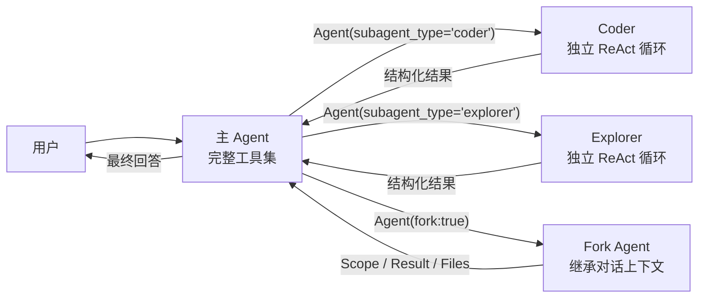
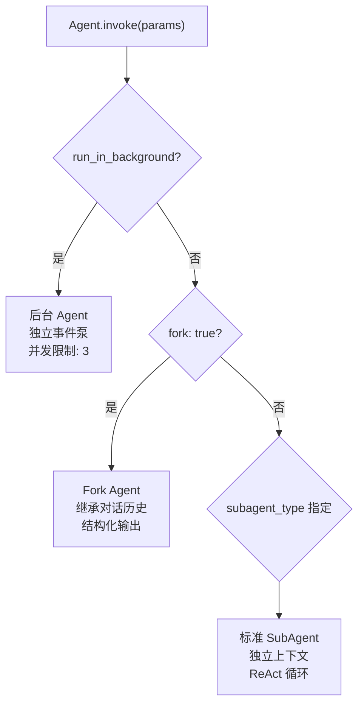
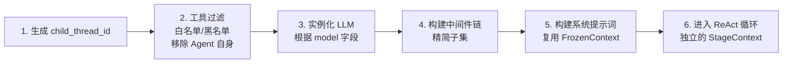
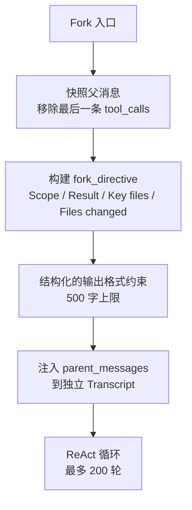
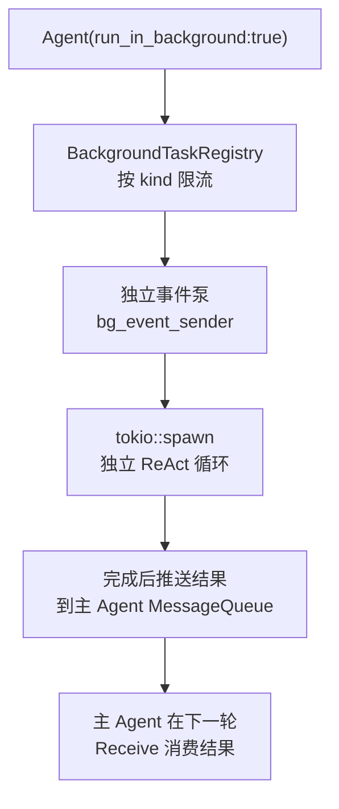
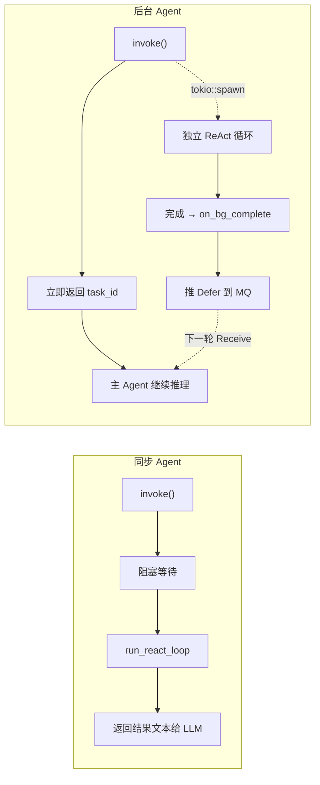
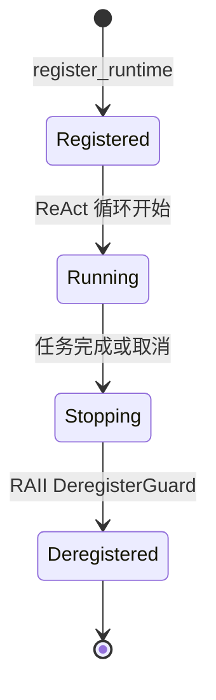
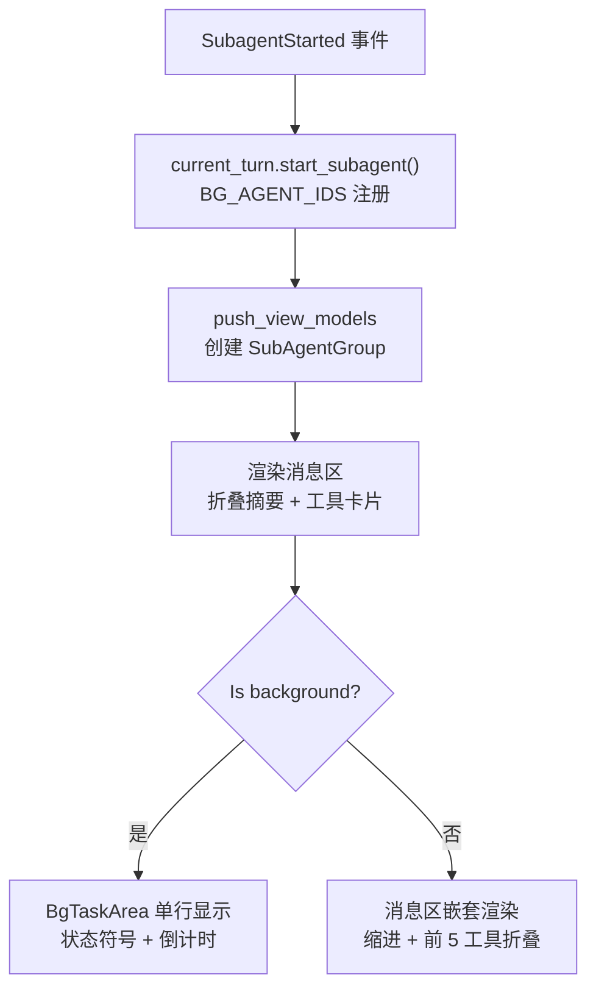
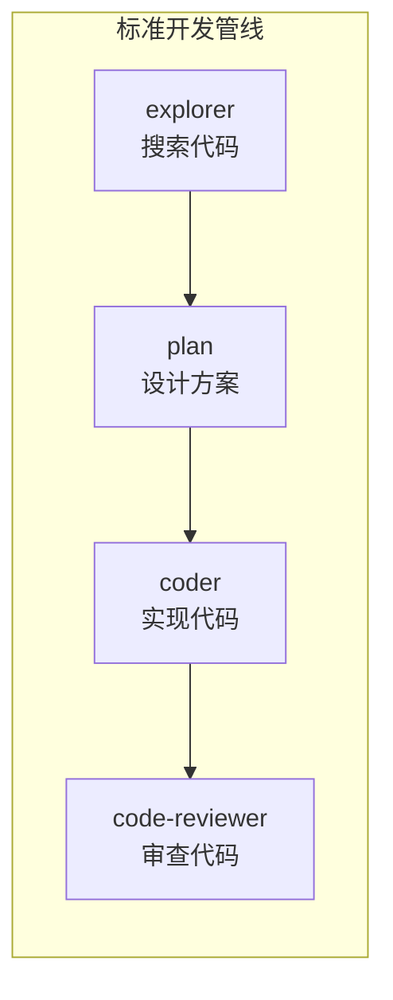

import { Aside } from '@astrojs/starlight/components';

## 概述

Peri 的 Multi Agent 系统允许主 Agent 将子任务委派给专业化的 SubAgent。每个 SubAgent 是独立的 ReAct 循环实例，拥有自己的上下文窗口、工具集合和系统提示词。

与单纯的多工具调用不同，SubAgent 引入了**上下文隔离**——子任务在独立上下文中运行，不污染主 Agent 的消息历史。任务完成后仅回传结构化结果。



## Agent 定义

SubAgent 通过 `.claude/agents/` 目录下的 Markdown 文件定义，前导元数据声明能力边界。

### 文件结构

| 布局 | 路径 | Agent ID |
|------|------|----------|
| 独立文件 | `.claude/agents/code-reviewer.md` | `code-reviewer`（文件名） |
| 目录形式 | `.claude/agents/explorer/agent.md` | `explorer`（目录名） |

### 前导元数据

```yaml
---
name: code-reviewer                              # 唯一标识符
description: Expert code review specialist.      # 何时使用的提示
tools: Read, Glob, Grep, Bash                    # 工具白名单
disallowedTools: Write, Edit                     # 工具黑名单
model: sonnet                                    # haiku | sonnet | opus | inherit
max_turns: 200                                   # 最大循环次数
permission_mode: default                         # 权限模式
skills: []                                       # 预加载的 skills
---
```

<Aside type="tip">
`tools` 为空时继承父 Agent 的全部工具。`model: inherit` 使用与主 Agent 相同的模型。
</Aside>

### 三层优先级

SubAgent 定义按优先级覆盖：

1. **项目级**（`{cwd}/.claude/agents/*.md`）—— 最高优先级，覆盖内置定义
2. **内置**（编译期嵌入）—— 6 个预定义 Agent，作为 fallback
3. **插件**（Plugin skills 中的 agent 定义）—— 额外搜索路径

具有相同 ID 的项目级文件**完全覆盖**内置定义，不合并。

## 内置 Agent 类型

Peri 编译期嵌入了 7 个内置 Agent，覆盖最常见的子任务场景：

| Agent | 模型 | 能力 | 适用场景 |
|-------|------|------|----------|
| **explorer** | haiku | 只读搜索 | 代码库探索、文件搜索、模式匹配 |
| **coder** | sonnet | 完整文件系统 | 代码实现、重构、文件编辑 |
| **plan** | inherit | 只读设计 | 架构设计、实现方案规划 |
| **code-reviewer** | sonnet | 只读审查 | 代码质量、安全、可维护性审查 |
| **verification** | sonnet | 构建/测试/检查 | 实现完成后验证正确性 |
| **web-researcher** | haiku | WebFetch/WebSearch | 网络资料调研、文档搜索 |
| **general-purpose** | inherit | 通用通配 | 未匹配到专用 Agent 时的 fallback |

<Aside type="caution">
`coder` 和 `general-purpose` 具有 `can_mutate` 能力（Write/Edit 工具），不能并行派发——存在文件冲突风险。其余只读 Agent 可以安全并发。
</Aside>

## 派发流程

主 Agent 通过 `Agent` 工具调用派发 SubAgent。`invoke()` 根据参数分为三条执行路径：



### 标准 SubAgent（subagent_type 指定）

最常用的派发方式。构建流程：



**中间件精简**：SubAgent 有意跳过部分中间件——GitAttribution（不需要 git 归属追踪）、AtMention（子任务上下文不需要 `@path` 解析）、Cron（独立生命周期不参与调度）、HITL（沿用父 Agent 的审批模式）。

**FrozenContext 复用**：SubAgent 复用主 Agent 在 `session/new` 时捕获的 CLAUDE.md 和 skill 摘要快照。从不重新读盘——保证父子 Agent 看到的项目知识完全一致。

### Fork 模式（fork: true）

Fork Agent 不是从零开始，而是**继承父 Agent 的完整对话历史**。这使它适合"在当前上下文基础上继续工作"的场景。



| 维度 | 标准 SubAgent | Fork Agent |
|------|-------------|------------|
| **对话上下文** | 独立空上下文 | 完整继承父历史 |
| **系统提示词** | 通过定义重建 | 复用父 FrozenContext |
| **工具集** | 定义 + 过滤 | 继承全部（仅移除 Agent 自身） |
| **输出格式** | 自由格式 | 结构化：Scope / Result / Key files / Files changed |
| **最大轮次** | 200（可配） | 固定 200 |

### 后台 Agent（run_in_background: true）

后台 Agent 在独立的 tokio 任务中运行，不阻塞主 Agent。通过 `BackgroundTaskRegistry` 管理生命周期。



**并发限制**：

| 类型 | 限制 | 取消机制 |
|------|------|----------|
| Shell | 5 | PID → SIGTERM |
| Agent | 3 | tokio AbortHandle |
| Workflow | 3 | oneshot kill signal |

<Aside type="note">
后台 Agent 使用独立事件泵（`bg_event_sender`）——因为主 Agent 的事件通道在回合结束时关闭，后台任务的生命周期必须独立于主 Agent 的回合边界。
</Aside>

### 同步 Agent vs 后台 Agent

两种派发方式在架构层面差异显著，不仅是"阻塞与否"的区别：

| 维度 | 同步 Agent（默认） | 后台 Agent（run_in_background: true） |
|------|------------------|--------------------------------------|
| **主 Agent 行为** | 阻塞等待，直到 SubAgent 完成 | 立即返回，主 Agent 继续下一轮推理 |
| **返回值** | SubAgent 的最终回答，直接作为工具结果回传 LLM | 任务 ID（如 `"Background agent bg-xxx started"`），结果通过 MQ 异步注入 |
| **取消策略** | Cascade（父取消 → 子取消） | Independent（父取消不影响子） |
| **事件通道** | 父 Agent 的 `event_handler`（通过 `subagent_event_forwarder` 转发） | 独立 `bg_event_sender`，不受父 Agent 回合边界影响 |
| **生命周期管理** | RAII `DeregisterGuard`（invoke 作用域退出即注销） | `BackgroundTaskRegistry` + tokio task AbortHandle |
| **TUI 渲染** | 消息区内联嵌套 SubAgentGroup（工具卡片实时流式刷新） | BgTaskArea 底部单行状态（完成后 3 秒自动消失），结果到达时以系统消息注入消息区 |
| **并发限制** | 每轮只能 1 个（同步串行） | 最多 3 个 bg Agent 并发 |
| **结果注入方式** | `extract_last_ai_text()` → `format_subagent_result()` → 直接作为 `invoke()` 返回值 | `on_bg_complete` 回调 → 推送 `Defer` 消息到主 Agent MQ → 下一轮 Receive 消费 |



<Aside type="caution">
同步 Agent 的阻塞是工具级别的——`invoke()` 内部 await `run_react_loop()` 直到完成。这意味着同步 SubAgent 内的所有工具调用事件**会实时推送到 TUI**（通过事件转发器），用户能看到 SubAgent 的执行过程。后台 Agent 的内部执行过程通过 bg_event_sender 推送，TUI 的 BgTaskArea 只显示状态概览。
</Aside>

## 生命周期

SubAgent 有完整的启动 → 运行 → 停止生命周期，通过回调机制与主 Agent 联动。

### 注册与注销



同步 SubAgent 使用 **RAII Guard** 自动注销——`DeregisterGuard` 在退出作用域时自动调用 `deregister_runtime`，panic 安全。

### 取消策略

| 策略 | 行为 | 适用场景 |
|------|------|----------|
| **Cascade** | 父 Agent 取消 → 子 Agent 取消 | 标准 SubAgent（默认） |
| **Independent** | 父 Agent 取消不影响子 Agent | 后台 Agent |

### 事件序列

标准 SubAgent 的事件时序：

```
SubagentStarted → before_agent hooks → ReAct 循环
  → SubagentStopped → lifecycle hooks → 结果回传主 Agent
```

## TUI 渲染

SubAgent 在 TUI 中渲染为**可折叠的嵌套分组**（`TuiSubAgentGroup`），包含 Agent 名称、工具调用卡片和状态指示器。



**渲染规则**：
- 折叠摘要行显示 "▶ N collapsed tools"（超过 5 个工具时）
- 子内容缩进 2 个空格，层级分明
- 后台 Agent 同步显示在底部 `BgTaskArea`（完成 3 秒后自动消失）
- 使用 `content_hash` 增量渲染，仅变更的组重绘

## 关键设计决策

| 决策 | 选择 | 理由 |
|------|------|------|
| **FrozenContext 复用** | 子 Agent 不重新读盘 | 确保父子看到完全相同的 CLAUDE.md/skills，防止行为漂移 |
| **中间件精简** | 5 个中间件有意跳过 | GitAttribution/AtMention/Plugin/Cron/HITL 与子任务无关 |
| **独立事件泵** | 后台 Agent 专用 bg_event_sender | 主通道在回合结束时关闭，后台任务需要独立生命周期 |
| **RAII 注销** | DeregisterGuard | panic 安全，防止活跃 Agent 映射泄漏 |
| **工具过滤三步骤** | 白名单 → 黑名单 → 移除 Agent 自身 | 安全可靠，防止递归派发 |
| **只读 Agent 可并行** | can_mutate=false 时可并发 | 无文件冲突风险 |

## 实践模式

Multi Agent 在 Peri 内部被广泛使用，以下是典型编排模式：

| 模式 | 流程 | 适用场景 |
|------|------|----------|
| **探索 → 规划 → 实现 → 审查** | explorer → plan → coder → code-reviewer | 完整的特性开发管线 |
| **并行调研** | 3 个 web-researcher 并发出动 | 多渠道资料收集 |
| **实现 + 后台审查** | coder 实现中，后台派 code-reviewer | 实施与审查并行，不阻塞主流程 |
| **上下文继承** | Agent Loop 诊断 → fork Agent 深入分析 | 基于已有上下文做增量工作 |



## 更多资源

- [Agent Loop](/peri-cool/posts/engineering/agent-loop/) — 每个 SubAgent 内部运行的 ReAct 循环引擎
- [System Prompt 设计](/peri-cool/posts/engineering/system-prompt/) — FrozenContext 的静态/动态分离策略
- [Hook 系统](/peri-cool/posts/engineering/hook-system/) — SubAgent 的 SubagentStart/Stop hook 触发路径
