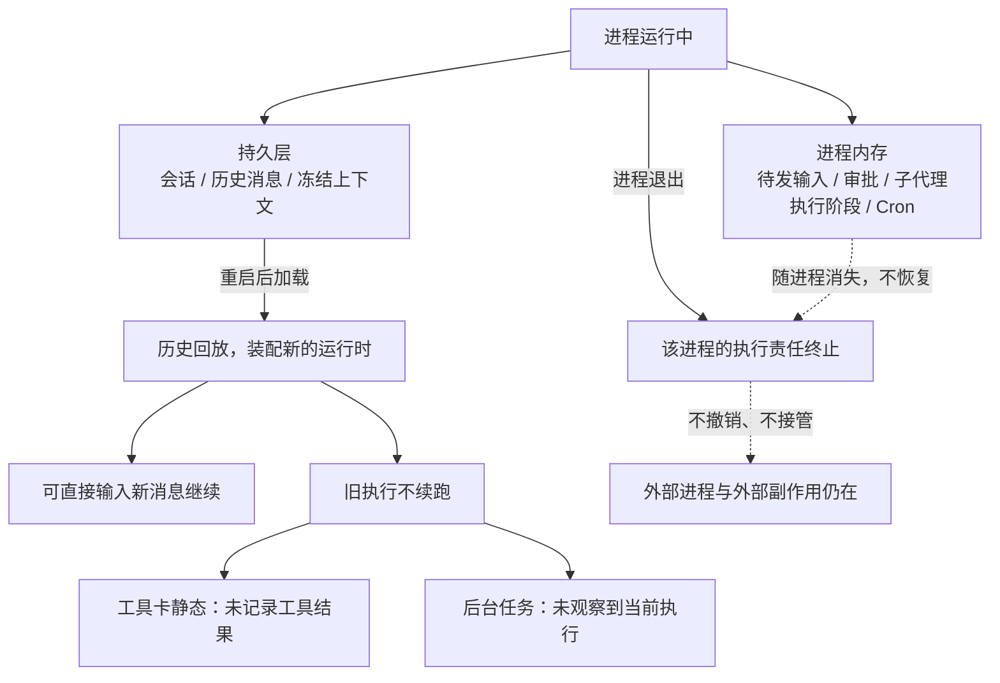

v4 撤销了持久执行恢复。这次变更删除的是机制本身，不是关掉一个开关。进程退出后，Peri 不再保存执行检查点，也不再在下次启动时扫描并接管旧执行。

把重启后的行为分成两组，边界就清楚了。

**重启后仍然成立的部分**

1. 会话列表、按 ID 加载、切换与历史回放都可用。
2. 入口不变：TUI 的 `/threads` 面板、`peri --continue`、`peri --resume <session-id>`。
3. 历史消息与冻结上下文随会话保留，不被当前启动环境覆盖。
4. 回放结束后会话处于空闲状态，可以直接输入新消息继续。

**重启后不会发生的部分**

1. 未完成的模型请求不会重新发起。
2. 未结束的工具调用不会重新执行。
3. 子代理与后台派发不会自动续跑。
4. 等待审批的请求不会重新弹出。
5. 排队但还没发送的输入不保留。
6. 活动目标与 Cron 任务不恢复，两者只存在于当前进程内存中。

|  | 进程运行中 | 进程退出后 |
| --- | --- | --- |
| 历史消息、冻结上下文 | 读写 | 保留 |
| 待发输入队列 | 内存 | 丢失 |
| 工具调用与子代理 | 执行中 | 终止，不接管 |
| 审批请求 | 等待 | 消失 |
| 活动目标、Cron 任务 | 内存 | 丢失 |
| 外部进程与外部副作用 | 不承诺 | 状态未知 |

## 重启后仍可继续

历史加载与续聊是两条独立的路径，v4 只删掉后者中的「续跑」部分。

1. 加载历史时，Peri 读取会话 ID、历史消息和冻结上下文，然后装配一套**新的**运行时。
2. 新的运行时没有旧执行的身份，也不继承旧执行的预算与阶段。
3. 因此历史回放不会把会话置为运行中：界面保持空闲，不出现运行动画。
4. 输入一条新消息，就是从当前历史重新开始一次执行。

这解释了为什么「会话可以继续」和「任务还在跑」是两件事。会话记录保留的是文本与配置，不是运行状态。相关命令与面板说明见[会话管理](/docs/guides/sessions/)。

## 不会恢复的运行态

以下状态在 v4 之后没有任何持久化载体，重启即结束。

1. **待发输入**：排队等待发送的消息只存在于当前进程，不承诺重启后恢复。
2. **审批请求**：需要用户裁决的请求不会在重启后重新出现，需要重新发起。
3. **子代理与后台任务**：旧委托不自动续跑，新输入也不会触发对旧任务范围的扫描。
4. **活动目标**：目标是进程内的运行期对象，重启后不再存在，见[长任务](/docs/features/long-running-tasks/)。
5. **Cron 调度**：调度器是纯内存实现，重启后任务丢失，见 [Cron](/docs/features/cron/)。

有一件事 Peri 主动不做：它不把外部副作用改写成成功、失败或已取消。取消请求已发出，不代表对应的外部任务已经停止；重启后也不保证外部结果再次送达。外部系统的状态需要各自核对。

## v4 为什么改成不恢复

撤销的依据是这条判断：恢复持久执行状态需要一个长期维护的义务面，而它换来的收益不足以抵消复杂度。

1. **恢复要维护的义务面很大**：处理批次、执行阶段、调用关联、执行预算、审批等待、待发队列各自都需要持久化，并在每次启动时对齐。
2. **对齐本身不可靠**：进程退出时可能正好停在模型请求、工具调用或审批的中间。外部副作用是否已经发生，Peri 无法在重启后判定。
3. **不判定就不会误判**：与其把状态恢复成「看起来正确」的近似值，v4 选择明确不接管，让状态差异暴露给用户。
4. **旧的恢复协议入口不再兼容**：这类调用返回明确的「不支持」错误，而不是伪成功。
5. **历史里的执行标记只表示历史事实**：曾经 started 但未结束的工具或子任务，不再作为当前执行的证据。

删除的范围包括 6 张执行恢复相关表，新建的会话库不再包含它们。旧库升级时会执行清理规划，但**真实用户库的升级不在本轮验证范围内**，完整端到端验证（真实远端存储、WASM、界面端到端）也没有完成。

## 历史里的未完成调用

重启后回看旧会话，最容易误读的是「有调用、无结果」的位置。

1. 历史工具卡是静态的：不带运行中状态，卡片上标记为不完整，文案是「历史记录不完整：未记录工具结果；未恢复执行。」
2. 显示历史的后台任务条目，状态文案是「未观察到当前执行」，表示当前进程没有实际观察到它在跑，而不是它已被终止。
3. 回放这些历史事实时，会话本身保持空闲，没有任何动画单元被拉起。
4. 界面上的「未观察到当前执行」不等于外部进程已停止，检查进程与资源状态仍然需要用户自己做。

这段占位表达的是「结果不在历史里」，而不是「执行失败」「已被取消」或「肯定没跑过」。三种结论都需要额外证据。

## 想接着做时怎么做

1. **先看工作区，不看会话记忆**：`git status`、`git log`，以及构建与测试的当前状态，才是任务进度的第一手证据。
2. **再回看历史**：确认上一次执行停在哪个工具调用、哪个文件、哪条命令上。
3. **需要核对时开一次只读回合**：让 Peri 只做检查和汇报，不修改文件，然后由你决定下一步。
4. **把验收状态写进仓库**：把「已完成」「待验证」记到文件里，而不是只留在会话中，这样重启、换机器或换会话都能读到。
5. **明确重发**：待发输入不会保留，需要继续的工作要重新输入，而不是等它自己出现。

## 限制与边界

1. **恢复不是回滚**：重启后不恢复执行，也不把工作区倒回旧状态；文件与仓库的修改保留在磁盘上。
2. **不复原不等于没有残留**：外部进程、外部副作用与远端资源可能仍在运行，Peri 不终止也不接管它们。
3. **工作流另有机制**：工作流日志支持从指定运行继续，与本文讨论的会话执行链路是两套机制，见 [RCRA 中断恢复](/posts/engineering/rcra-interruption-recovery/)。
4. **旧客户端不保证兼容**：SDK 侧的协调器模式需要随本次变更调整，旧恢复式调用会收到明确的「不支持」错误。
5. **没有实测数据**：重启后续聊的额外 token 成本、恢复耗时与恢复成功率，本次没有实测数据，因此不在这里给出数字。
6. **未验收范围**：真实用户库升级、真实远端存储、WASM 与界面端到端测试不在本轮结论内。

## 相关实现

- 设计依据：`docs/design/rcra-message-activation.md`、`docs/design/session-async-tasks.md`
- 契约：`docs/standards/architecture-contracts.md`（ARC-RCRA-MESSAGE-001）
- 存储形状与清理：`peri-resources/src/sessions/canonical.rs`、`peri-resources/src/sessions/schema_cleanup.rs`
- 界面文案与静态卡片：`peri-tui/src/kit/acp_events/tool.rs`、`peri-tui/locales/zh-CN/main.ftl`
