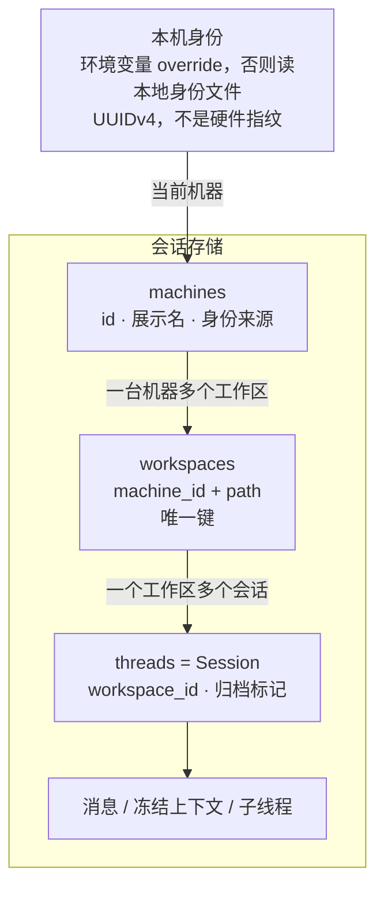
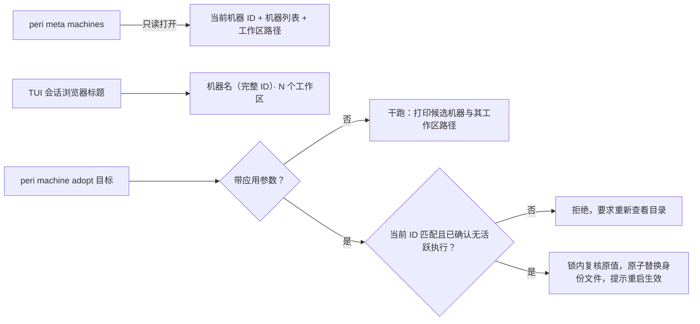

同一份代码放在两台机器上，路径完全相同。这两台机器上的会话应该属于同一个工作区吗？

v4 的答案是：不属于。会话归属由三层实体决定，路径只是其中一层。

1. **Machine**：一台机器一份身份，来自本地文件里的 UUID，不来自硬件。
2. **Workspace**：机器加路径，唯一确定一个工作区。
3. **Session**：会话就是一个线程记录，挂在某个工作区下面。

这三层的关系如下。

## 归属键是机器加路径

1. **唯一约束落在「机器 + 路径」这一对上**：同一台机器上的同一个路径只能有一行工作区记录，重复登记不会产生第二行，会读回已经存在的那一行。
2. **路径取的是工作区根，不是启动目录**：在 Git 仓库的任意子目录启动，归属都落到该 worktree 的根路径。
3. **linked worktree 各自算一个工作区**：它们各有自己的根路径，因此互不合并。
4. **非 Git 目录按启动目录建归属**：拿不到仓库根时，用启动时的工作目录。
5. **无法证明来源时标注为未验证**：路径来源有三种取值，未验证表示当时无法确认它确实是一个已验证的仓库根。
6. **机器是唯一键的一部分**：所以两台机器上的同一个路径是两个工作区，不是共享的一个。
7. **子会话继承父会话的归属**：子线程不会另建工作区。
8. **普通操作不改写归属**：加载、继续、列表、归档都不会重写机器、路径或工作区关联。

## 机器身份从哪里来

机器身份是一串 UUID，解析顺序固定。

1. **先看环境变量**：设置了身份环境变量且能解析为 UUID，就用它，并且**不会**写进默认身份文件。
2. **否则读本地身份文件**：默认位置在用户主目录下的 Peri 配置目录内。
3. **文件不存在时生成**：生成 UUIDv4，写入权限受限的临时文件，原子发布到目标路径；并发初始化只有一个赢家。
4. **文件存在但内容不能解析为 UUID 时报错**：不会静默生成另一份身份掩盖问题，文件原样保留。
5. **身份在进程内只读一次**：启动之后修改环境变量不会切换身份，必须重启进程。
6. **不使用硬件指纹**：主机名、MAC 地址、磁盘序列号、硬件标识都不参与推导。

第 6 条是刻意的取舍：身份要稳定到可以长期绑定归属，又不能在硬件变化、主机名变化或迁移后漂移。代价是需要你保留那份文件。

## 用户能看到什么

1. **命令行目录**：`peri meta machines` 打印当前机器 ID、每台机器的展示名与标记、每台机器下的工作区路径；加 `--json` 输出机器可读结构。
2. **只读语义**：这个命令走只读打开，不建库、不迁移、不登记；机器身份的初始化只发生在写路径，所以它不会替你把旧库顺手升级。
3. **TUI 里的入口**：会话浏览器标题显示当前机器名、完整 ID 与工作区数量。
4. **协议面**：客户端可以列出机器与工作区，归档会话需要相应能力协商。

## 身份文件丢了怎么办

1. **丢失会得到新身份**：下次启动生成新的 UUID，旧的机器行与工作区仍然在库里，但不会自动迁移到新身份下。
2. **列表如实展示新旧**：你会看到两台机器记录，其中一台是本次生成的。
3. **认领需要显式操作**：`peri machine adopt <target>` 把当前机器切换成目录里已有的某台机器。
4. **默认是干跑**：不带应用参数时，命令只打印候选机器与它名下的工作区路径，然后正常返回。
5. **应用需要三项确认**：应用参数、当前机器 ID、无活跃执行确认，缺一项就拒绝。
6. **当前机器 ID 必须匹配读取时的值**：不匹配会提示重新查看目录，避免在身份已变的情况下写入。
7. **切换后必须重启进程**：进程内已经缓存的身份无法热切换。
8. **三类目标被拒绝**：非 UUID 的目标、目录里不存在的目标、以及来源为占位身份的记录。

## 不做的事

1. **机器 ID 不是凭证**：身份文件与环境变量都不是安全凭证，不能用来做权限隔离。
2. **不承诺跨实例唯一执行**：执行所有权与多实例协调属于部署方的责任，Peri 不发执行租约，也不做实例隔离。
3. **不认领没有显式切换的旧身份**：新身份不会自动继承旧工作区。
4. **不因为目录移动而改绑旧会话**：旧归属行保持原路径，旧绑定按自身快照复核，可能失败关闭而不静默迁移。
5. **不做跨机器搬家**：改名能力目前只有内部端口，没有用户入口；跨机器继续工作的方式是新建归属的会话并显式继承历史。
6. **只读与写打开是两种能力**：写打开失败会降级为只读，浏览与进入不受影响，但新建会话会在写入前失败，不假装可写。

## 未验收与文档漂移

1. **真实远端库验收尚未执行**：压缩后的形状已接入，远端实库发布验收仍在待办列表中。
2. **端到端用例没有机器分区**：现有工作区场景用例通过隔离主目录获得各自的机器身份，但没有断言跨机器隔离。
3. **切换命令没有集成测试**：`peri machine adopt` 只在单元测试层面覆盖，命令行输出没有自动化断言。
4. **一处推断未实跑验证**：在从未写打开过的全新主目录下，只读目录命令会因身份未初始化而报错，而不是自动生成身份。这是从只读链路与身份初始化时机推出的结论，未实跑验证。
5. **文档漂移**：历史计划文档里出现过更高的代数编号，那是开发期编号；当前会话库版本以代码常量为准，不在本文引用旧编号。

## 相关实现

- 设计依据：`docs/design/storage-v2-machine-workspace-session.md`、`docs/design/session-id-environment.md`
- 身份与归属：`peri-resources/src/sessions/machine.rs`、`peri-resources/src/sessions/sqlite_store/workspace_identity.rs`
- 形状与迁移：`peri-resources/src/sessions/canonical.rs`、`peri-resources/src/sessions/storage_v11_migration.rs`
- 用户入口：`peri-tui/src/cli_meta.rs`
