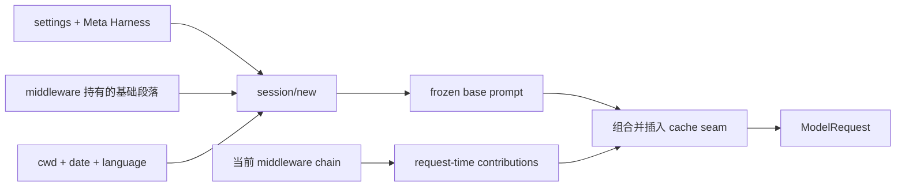

Peri 的 System Prompt 不是一段每轮重新拼接的文本，也不是全部内容都永久静止。当前结构分为
两部分：会话级冻结的 base prompt，以及每次模型请求从当前 middleware 链读取的 contribution。

## 两部分如何组合



base prompt 随会话快照持久化。load、resume、fork 与 SubAgent 复用 owner snapshot，
不能因为磁盘上的项目指引或覆盖文件后来变化而重新生成另一份前缀。

middleware contribution 在 `before_agent` 完成能力目录准备后读取。项目指引、Skills 摘要、
Git attribution 与当前 direct/deferred 工具说明可以通过这条路径追加，但不能重写 frozen base。

## 段落所有权就是能力边界

基础身份、语言、审批、提问、Skills 与 SubAgent 说明分别由对应 middleware 持有。
middleware 没有装配时，它持有的段落、工具和 Hook 应一起消失。

这避免了两种漂移：模型仍被告知一个已经关闭的工具，或者工具仍可调用但安全与使用说明
已经消失。Meta Harness 负责在冻结期覆盖段落或关闭整个 middleware；运行时不能再维护
一套平行开关。

## System Prompt 不进入 Transcript

用户消息、模型回答、ToolUse、ToolResult 和异步通知属于 Transcript。System Prompt 独立于
Transcript，因此 Compact 与 rewind 不会把它当普通消息删除或改写。动态 contribution 也只
存在于当次 ModelRequest，不会在历史字符串上逐轮累加。

## cache seam 是 transport 契约

Peri 在冻结区与动态区之间放置一个内部控制标记：

```text
frozen base → cache boundary → request-time contribution
```

支持显式 cache breakpoint 的 Provider 可以据此拆分静态和动态 system block；其他 Provider
只保证移除标记并保持原有字节顺序。控制标记必须在 wire request 构造前被消费，不能泄漏给模型。

缓存命中仍取决于 Provider、模型、TTL 和实际请求。稳定前缀提供的是可复用条件，不是费用或
命中率承诺。

## 确定性要求

- 段落和 contribution 按生产链顺序组合；
- 工具定义与能力说明使用稳定顺序，不能依赖 `HashMap` 迭代；
- 空 contribution 不应改变 base prompt 的字节；
- contribution provider 返回自有字符串，不能持锁跨越模型请求；
- 重复或损坏的缓存边界必须 fail closed。

排查问题时分别比较 frozen snapshot、middleware chain、request-time contribution 和 Provider
最终序列化结果。只观察模型回复无法证明是哪一层发生了漂移。

相关内容：[Meta Harness](/posts/engineering/meta-harness/) · [工具系统](/docs/features/tools/) · [上下文工程](/docs/features/context-engineering/)
